# happa redesign · Phase 1: design direction "Bahi"

Status: **proposal, not merged**. Branch `redesign-direction` (docs and mocks only, no `www/` change).
Baseline analysed: PR #356 `ui/sleek-pass` (head `a89d250d`) compared with `main` (`6032262d`).
Mocks: `mocks/*.html` → `mocks/*.png` (390×844 @2x phone, 1366×768 desktop). Side-by-side page: [`index.html`](index.html).
Includes the owner's **theme customization** requirement (2026-11-07): a theme-driven token architecture, 12 themes × Light / Dark / System, and a Theme Gallery. See §4.

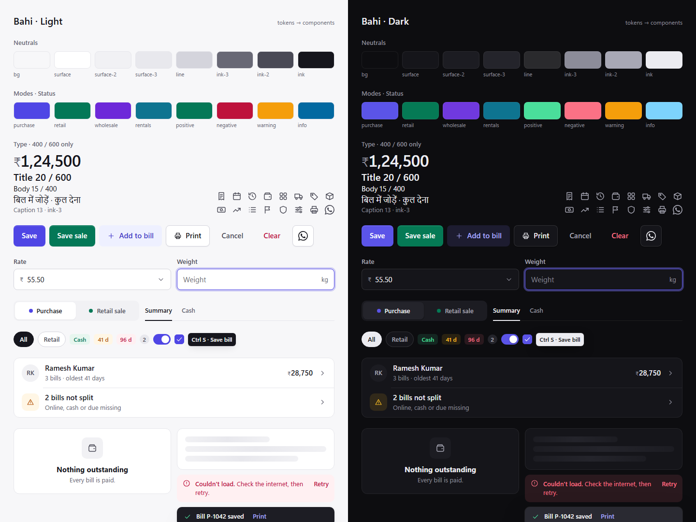

---

## 1. What we have today (analysis)

### Architecture (unchanged by this redesign)
- Vanilla-JS PWA in `www/`, no bundler. The same `www/` ships in the Capacitor Android app (minSdk 30, Chromium WebView).
- 23 HTML templates (`www/templates`). Shell templates (login, side menu, dialogs) load first. Billing, Today and Cash load eagerly. Other pages are fetched on first open.
- 32 stylesheets are joined into one `css/app.css` (211.8 KB raw, 37.0 KB gzip). `index.html` links only that file (1 stylesheet before login is a tested budget).
- The CSP is enforced: `script-src 'self'` plus one hash, `style-src 'self' 'unsafe-inline'`, `font-src 'self' data:`. There are no web fonts and no CDNs. Inline `<svg>` is fine.
- Navigation:
  - **phone**: two floating square buttons (☰ and 🔔) with no page title. The bottom bar has Billing, Today, History, Outstanding and More. More opens the same side drawer as ☰.
  - **desktop (≥1024)**: a permanent sidebar with an indigo-gradient header, a business switch and Alt+1…9. Ctrl+S / Ctrl+P / `/` / `?` / Esc.
- Pages: Billing (purchase / retail sale), Wholesale, Today (Summary, Cash), History, Outstanding, Money, Insights (Seasons, Trends, Traffic), Statements, Stock, Rates, Expenses, Anomalies, App health, Admin, Diagnostics, Settings, Ask, and Rentals (Rent, Tenants, Properties; loaded on demand).

### Styling health (measured with `tools/analyze-css.cjs` on #356)

| Metric | Value | Why it matters |
|---|---|---|
| `style="…"` in templates | **287** (cash-management 93, billing 52, modals 29, wholesale 26) | Layout and colour live outside the system |
| Inline style / `.style.*` writes in JS | **552**, with **482** hex colours (cash-management.js 104/88, wholesale-sales.js 59/39, diagnostics 49, history 47, admin 46, miscellaneous 45, outstanding 42) | Every screen paints its own colours, so dark mode needs a bridge |
| Dark-mode bridge | **107** `[style*="…"]` attribute selectors in variables.css | Fragile: a new hex in JS breaks dark mode silently |
| Raw colours in CSS | 458 (268 in variables.css, incl. the bridge) | |
| `!important` | 81 | |
| Distinct font sizes | **28** (14px ×139, 12 ×63, 13 ×62, 16 ×47, 15 ×46, 18 ×31 …) | No type scale in practice |
| Distinct radii | **24** (var(--radius) 42, 8px 39, 10px 30 …) | |
| Distinct box-shadows | **37** | |
| Font weights | 500 ×163, 600 ×89, 700 ×4 | See the Roboto / Segoe / Devanagari note in §3.3 |
| "card" classes | **38** (`modern-card`, `stat-card`, `report-card`, `settings-card`, `item-card` …) | Everything is a card, so nothing stands out |
| Button classes | **59** | `buttons.css` exists, but pages keep their own buttons |
| Selectors defined in >1 file | 113 (`.bill-totals`, `.total-row` in buttons.css **and** totals.css; `.summary-item` in billing + day …) | Order-dependent cascade |
| Gradients | 16 in CSS (#356 adds indigo→violet on the primary CTA, the active pill, heroes and the sidebar header) | |
| `backdrop-filter` | 16 uses (frosted bars in #356) | GPU cost on low-end Android WebViews |
| Emoji as icons | 77 in templates, 373 in JS, 85 i18n strings start with an emoji (`📊 Today's Summary`) | They render as 3D Fluent emoji on Windows and Noto on Android, ignore `currentColor` and dark mode, and differ in size and weight |

### What the #356 screenshots show (current baseline)
- **There is no page title on the phone.** The top 140 px hold two floating 56 px squares (☰, 🔔). The user tells pages apart only by the content.
- **Too many equal-weight boxes.** Billing stacks a mode pill, three draft buttons, an error banner, a pink-bordered wrapper, a card with a purple left stripe, a summary box, a gradient CTA and a table. Nothing leads the eye to the next step.
- **Labels sit left of the inputs** (fixed 100 px). In Hindi they wrap, and inputs shrink to half width.
- **Save is far below the fold** on the phone, after payment, notes and date. The Save / Print row on desktop overlaps the summary column (see `current/desktop-light-billing.png`).
- **Gradients and glows** sit on the primary CTA, the active mode pill, heroes and the sidebar header. They compete with the content, and the brand reads "template dashboard".
- **Colour carries no meaning.** Indigo is the brand, purchase, links, active states and hero cards all at once. Red borders appear on empty payment inputs before the user has typed.
- **Emoji icons** look playful and inconsistent next to the serious money figures.
- The Today, Outstanding and Money heroes put white text on violet gradient cards, so dark mode and light mode look like two different apps.

---

## 2. Direction: "Bahi" (बही, the ledger book)

A calm, ink-on-paper ledger. Numbers are the hero, the chrome stays quiet, and colour only means something. It takes Linear's restraint, Raycast's precise and tactile controls, and Fluent 2's per-platform adaptation, applied to a shop that counts money and grain.

**Five principles**
1. **Numbers first.** Money and weight figures are the largest, darkest things on screen. They use tabular figures, and the ₹ sign is smaller and muted. Labels are quiet.
2. **Quiet chrome.** Whitespace and 1 px hairlines replace boxes. A panel exists only for a real group (a list, the bill summary). There are no side stripes and no gradients. Shadows are only for things that float (menus, sheets, dialogs, toasts).
3. **Colour = meaning.**
   - The UI is neutral graphite.
   - Indigo is used only for the current action and selection.
   - Business modes are small identity dots (purchase, retail, wholesale, rentals).
   - Red, amber and green appear only for state (error, aging due, paid).
4. **One obvious next step.** There is one filled button per screen (the existing rule), and it is always reachable: a sticky action bar on the phone, the summary footer on desktop.
5. **Native per platform, one system.** Android gets a title bar, a bottom bar and sheets. Desktop gets a sidebar, a page header, shortcuts and a denser layout. Both use the same tokens and components.

### Before → after (Billing, phone)
| Now (#356) | Proposed |
|---|---|
| 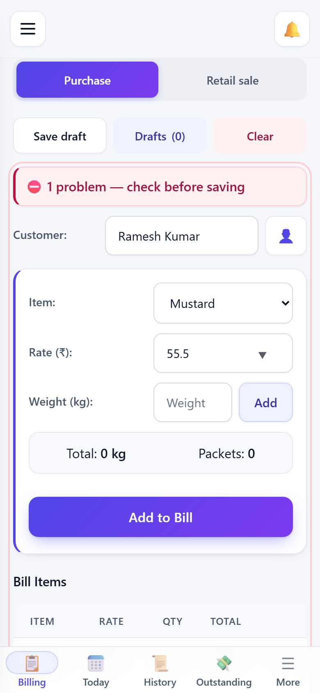 | 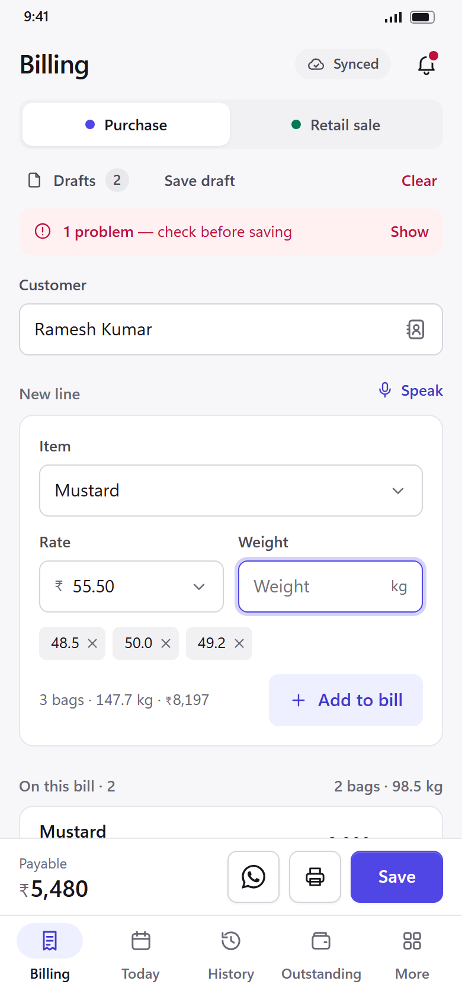 |
| 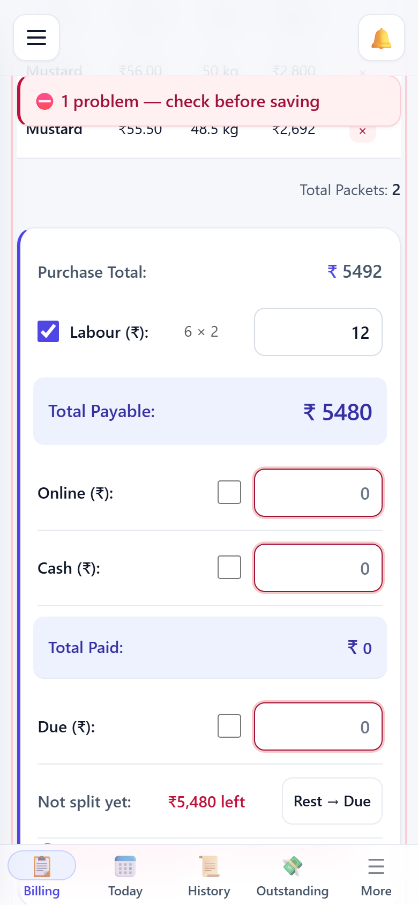 | 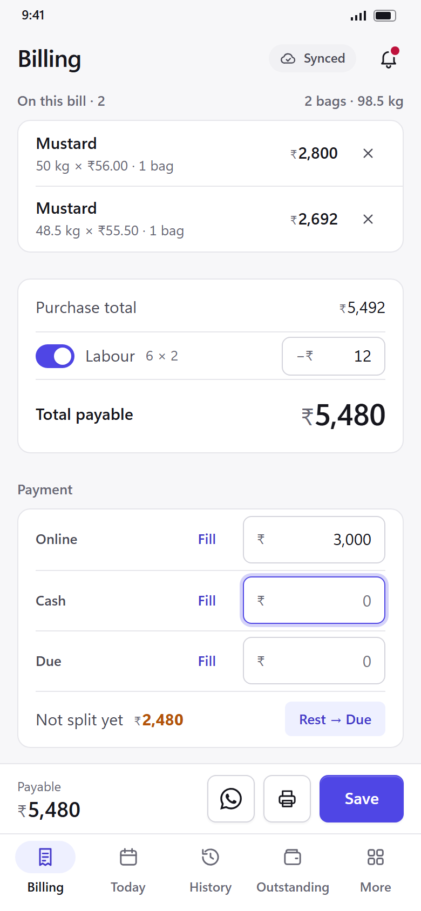 |

### Dark, Hindi, Today, Outstanding, More
| Billing · dark | Billing · Hindi | Today | Today · dark | Outstanding | More (sheet) |
|---|---|---|---|---|---|
| 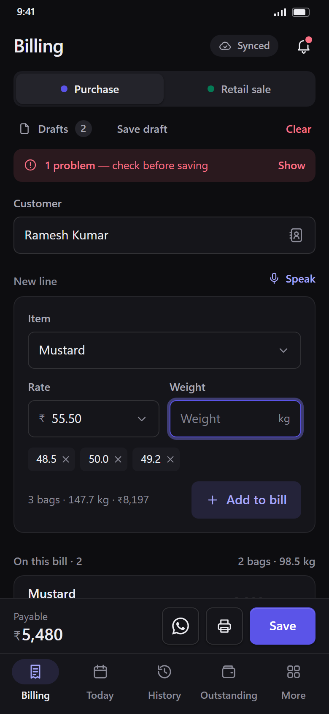 | 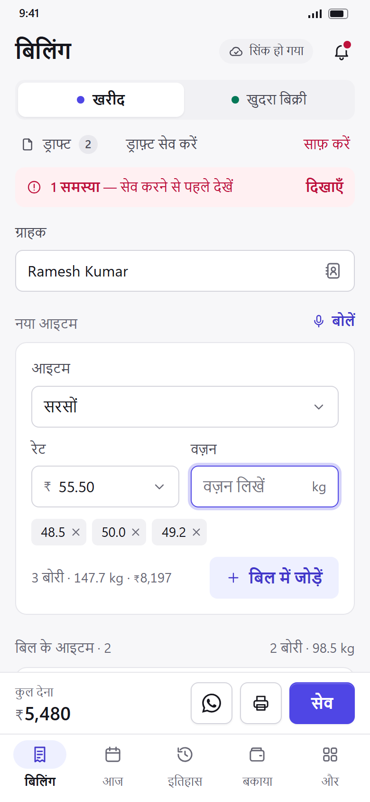 | 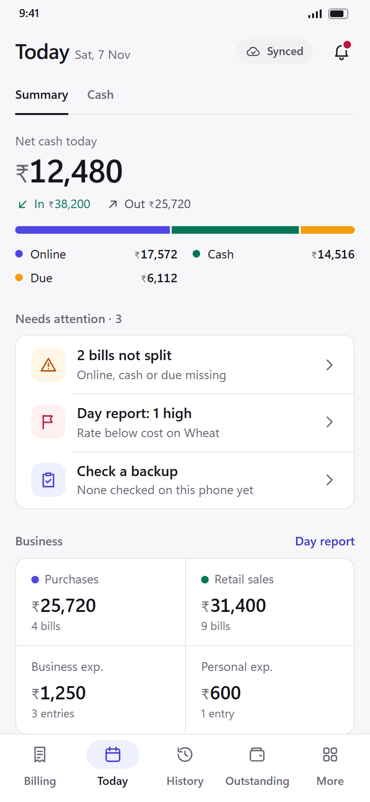 | 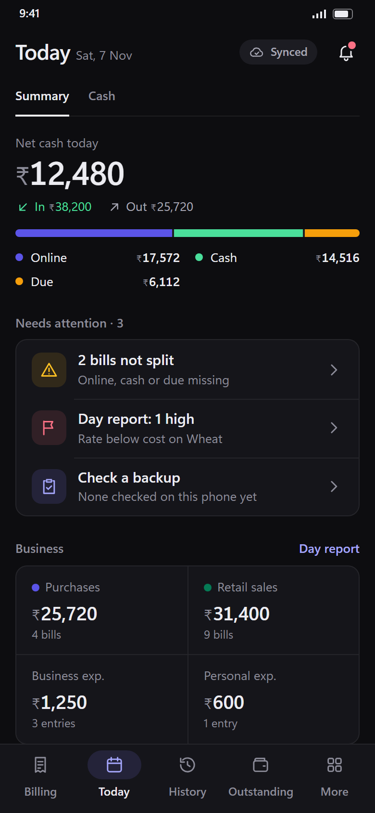 | 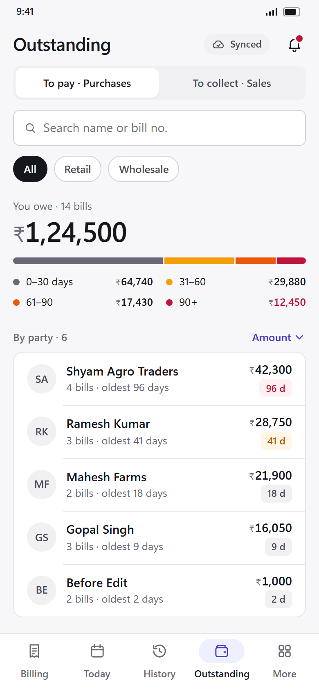 | 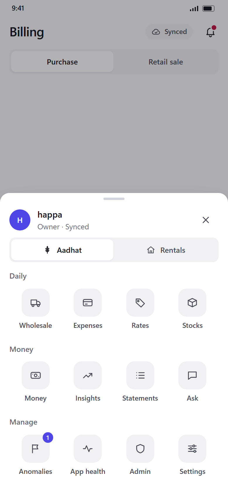 |

### Desktop
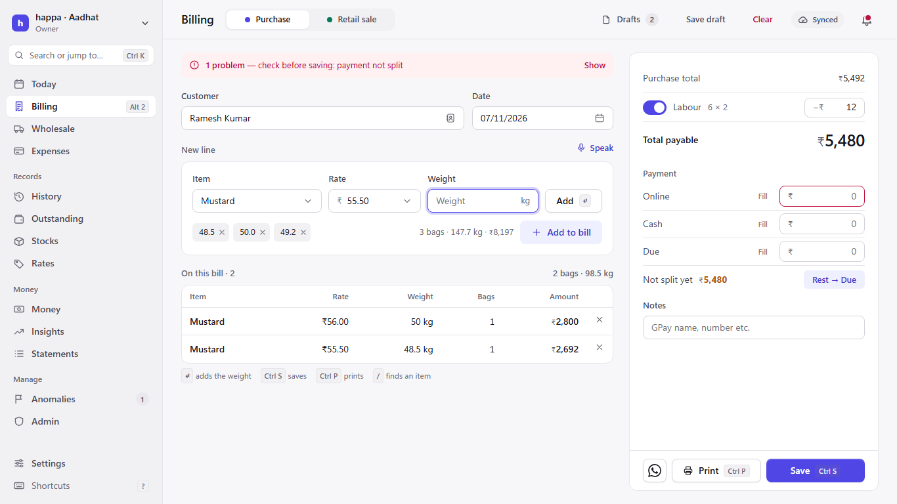
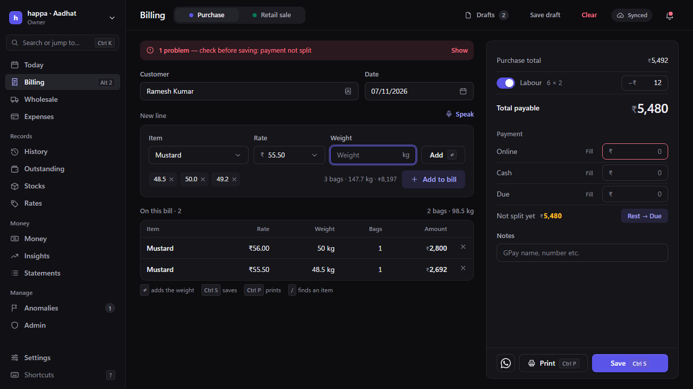
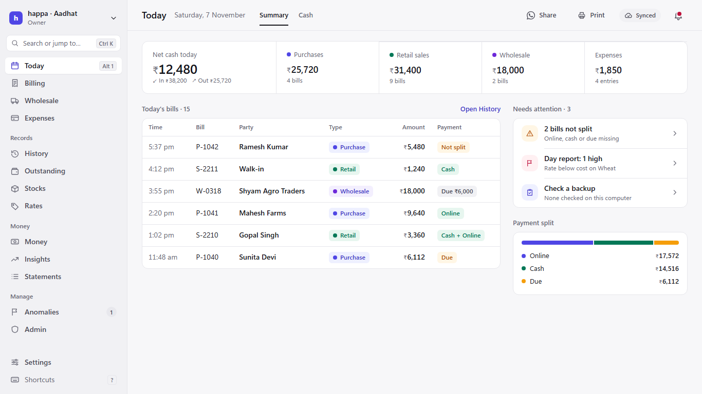
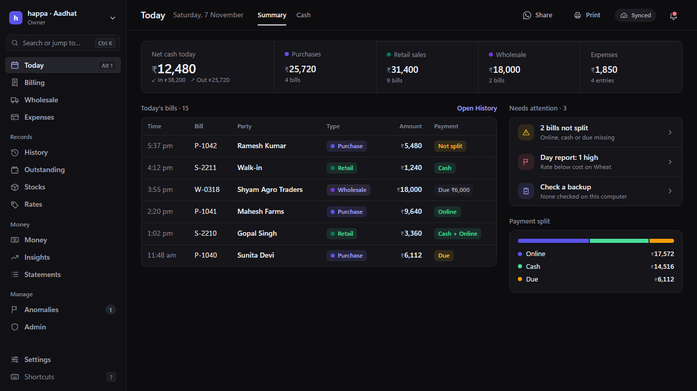

> Mock figures (e.g. "2 bills not split", the line preview "3 bags · 147.7 kg · ₹8,197") are **illustrative**. The rollout shows only figures that exist today unless the owner asks for new ones. Every new number gets a spec ID and an oracle test (AGENTS.md "Numbers on screen").

---

## 3. Design system (proposed tokens)

**The token architecture is theme-driven from the start.** There are three layers, and components read only layers 1 and 2:

| Layer | What | Examples | Who sets it |
|---|---|---|---|
| 1. Semantic | Meaning-based colours, elevation, focus | `--bg`, `--page-bg`, `--surface(-2/-3)`, `--line(-strong)`, `--ink(-2/-3)`, `--accent(-text/-soft)`, `--on-accent`, `--mode-*`, `--positive/negative/warning/info(-soft)`, `--e1..3`, `--focus` | Every theme (light block + optional dark block) |
| 2. Component | Shape, material and type roles, derived from layer 1 by default | `--r-control`, `--r-panel`, `--r-chip`, `--r-sheet`, `--rule-style`, `--panel-bg/-border/-shadow/-blur`, `--bar-bg/-blur`, `--appbar-bg/-ink`, `--seg-track/-on`, `--input-bg/-border`, `--btn-primary-bg/-ink/-shadow`, `--btn-sale-*`, `--toast-*`, `--font-ui/-display/-num/-hero`, `--w-display`, `--tracking-display` | Defaults in the base file. A theme overrides only what makes it different |
| 3. Components | `.btn`, `.input`, `.seg`, `.panel`, `.row`, `.tabbar` … | They read tokens and never raw colours | Base CSS only. A theme may add a **few** scoped rules (`[data-theme="material"] .input {…}`) when tokens can't express it |

Layout, density and motion tokens (`--fs-*`, `--sp-*`, `--control-h`, `--row-h`, `--dur-*`) are **not** per theme. They are inherited from `:root` and adjusted by `.desk` (density) and `[lang="hi"]` (script). This keeps layouts identical across themes. Nordic and Premium nudge only `--gutter`, `--section-gap` and the hero size.

The source of truth for this proposal is `mocks/src/ds.css` (base + Modern Minimal: 26.8 KB raw / 6.0 KB gzip with the component rules) plus `mocks/src/themes/*.css` (one file per theme). Phase 2 moves them into `www/css/variables.css` + `www/css/themes/*.css` and the component sheets. **The old token names stay as aliases** (`--primary-color: var(--accent)`, `--card-bg: var(--surface)` …), so all 32 stylesheets pick up the new look, in every theme, without a rename.

### 3.1 Colour (Modern Minimal, the default theme; the other 11 are in §4)

| Token | Light | Dark | Use |
|---|---|---|---|
| `--bg` | `#f7f7f9` | `#0d0d10` | Canvas |
| `--surface` | `#ffffff` | `#15151a` | Panels, inputs, bars |
| `--surface-2` | `#f1f1f4` | `#1c1c22` | Segmented track, chips, icon tiles, sidebar (light) |
| `--surface-3` | `#e8e8ed` | `#24242b` | Pressed, active segment (dark) |
| `--line` / `--line-strong` | `#e6e6eb` / `#d4d4dc` | white 7 % / 12 % | Hairlines / input borders |
| `--ink` | `#16161d` (18.0:1) | `#ececf1` (15.5:1) | Text, figures |
| `--ink-2` | `#4a4a56` (8.7:1) | `#a8a8b5` (7.7:1) | Labels, secondary |
| `--ink-3` | `#686875` (5.5:1) | `#8c8c99` (5.5:1) | Captions, meta (AA on surface and bg) |
| `--accent` (fill) | `#4f46e5` (white 6.3:1) | `#5b54e8` (white 5.4:1) | The one primary button, selection, focus |
| `--accent-text` | `#4338ca` | `#a5a6fb` | Links, tonal buttons |
| `--accent-soft` | `#eef0ff` | indigo 14 % | Tonal button, active tab pill |

**Mode accents** are identity, never status. They show as an 8 px dot, a tag and the colour of the Save button on that screen.

| Mode | Light | Dark fill | Notes |
|---|---|---|---|
| Purchase | `#4f46e5` | `#5b54e8` | Same as brand accent (purchase is the default screen) |
| Retail sale | `#047857` | `#057a55` | Save button is green in sale mode (as today) |
| Wholesale | `#6d28d9` | `#7039df` | Kept from #354 for continuity |
| Rentals | `#0e7490` | `#0e7490` | Separates the second business at a glance |

**Status:**
- positive `#047857` / `#4ade9b`;
- negative `#be123c` / `#fb7185`;
- warning text `#b45309` / `#fbbf24` (dot `#f59e0b`);
- info `#0369a1` / `#7dd3fc`.

Each has a `-soft` background (tinted at 12 % in dark). Dues show in **ink**, not red. They turn amber after 30 days and red after 90 (an age tag), so red keeps its meaning.

The contrast of every text token was checked against `--surface`, `--bg` and `--surface-2` (≥4.5:1). E2E axe stays the gate.

### 3.2 Typography

System faces only (the CSP has no font origin):
`"Segoe UI Variable Text", "Segoe UI", system-ui, -apple-system, Roboto, "Noto Sans", Arial, "Noto Sans Devanagari", "Nirmala UI", sans-serif`

| Token | Phone | Desktop | Hindi (phone) | Use |
|---|---|---|---|---|
| `--fs-caption` | 12 | 12 | 12 | Meta, tab-bar labels |
| `--fs-sm` | 13 | 13 | **14** | Labels, section titles, chips |
| `--fs-body` | 15 | 14 | **16** | Body, inputs |
| `--fs-lead` | 17 | 16 | 17 | Dialog titles |
| `--fs-title` | 20 | 18 | 20 | Metrics, action-bar total |
| `--fs-display` | 28 | 26 | 28 | Total payable |
| `--fs-hero` | 34 | 30 | 34 | One hero figure per page |
| App bar title | 22 | 18 (page header) | 22 | |

- Line height is 1.45 for body text (Hindi 1.6) and 1.1–1.2 for figures.
- Letter-spacing is −0.02 em on figures and titles, and **never** on Devanagari.
- There is **no uppercase anywhere**, because Devanagari has no case. Section titles are sentence-case 13 px in `ink-3`.
- `font-variant-numeric: tabular-nums` applies to all money and weight figures.

### 3.3 Weights: the Roboto / Segoe / Devanagari problem
#356 uses `font-weight: 500` 163 times. It looks right only on Android Roboto (which has a Medium face). Elsewhere:

| Face | Real weights | 500 renders as | 600 renders as |
|---|---|---|---|
| Roboto (Android) | 100, 300, 400, 500, 700, 900 | Medium ✓ | **Bold 700** |
| Segoe UI (Win 10) | 300, 400, 600, 700, 900 | **Regular 400** (no emphasis) | Semibold ✓ |
| Segoe UI Variable (Win 11) | continuous | 500 ✓ | 600 ✓ |
| Nirmala UI (Hindi on Windows) | 350, 400, 700 | Regular | **Bold** |
| Noto Sans Devanagari (many Android builds) | 400, 700 | Regular | **Bold** |

Proposal: use **two weight tokens and nothing else**.
- `--w-strong: 600` (titles, figures, buttons) and `--w-label: 600` (labels, tabs, chips).
- In Hindi, `--w-label: 400`, so labels stay regular and only titles and figures are bold (compare `mocks/phone-light-hi-billing.png`).
- In the Android app (`html.platform-android`, set once at start from `Capacitor.getPlatform()`), `--w-strong: 500` gives Roboto Medium, the native Material emphasis, instead of a heavy Bold.
- Check on a real phone in Phase 4.

### 3.4 Spacing, radius, elevation, motion

- **Spacing:** a 4 pt scale `--sp-1…10` = 4, 8, 12, 16, 20, 24, 32, 40. The gutter is 16 on the phone, 28 on desktop. Gaps are 24 between sections, 12 inside a group and 6 between a label and its control.
- **Radius:**
  - `--r-xs` 4 (kbd)
  - `--r-sm` 6 (small buttons, chips in rows, tags)
  - `--r-md` 8 (buttons, inputs)
  - `--r-lg` 12 (panels, menus)
  - 16 only for the top corners of a sheet
  - `--r-full` for pills, avatars and badges

  The 20 px "bubbly" radii are dropped.
- **Elevation:**
  - **0** hairline only (default for all content)
  - **e1** 1 px shadow (active segment, secondary button)
  - **e2** menus, popovers, tooltips
  - **e3** sheets, dialogs, toasts

  In dark mode, elevation comes from a lighter surface plus a 1 px white-6 % ring, not from a shadow. The primary button gets a 1 px inner top highlight (the "lit" Raycast feel) instead of a gradient.
- **Motion:**
  - `--dur-1` 120 ms: press, hover, colour.
  - `--dur-2` 200 ms: tabs, chips, toasts in.
  - `--dur-3` 280 ms: sheets and dialogs.
  - Easing is `cubic-bezier(.2,.8,.2,1)`.
  - Animate only `transform` and `opacity`. Pressed buttons scale to 0.98.
  - No animation on scroll containers or totals. `prefers-reduced-motion` turns it all off (already global).

### 3.5 Iconography: decision

| Option | Size | CSP | Effort | Verdict |
|---|---|---|---|---|
| Keep emoji | 0 | ✓ | 0 | ✗: looks different per OS, ignores theme colour, too playful for money |
| **Inline SVG sprite** (symbols in `navigation.html`, `<svg class="i"><use href="#i-name"/></svg>`) | **51 icons ≈ 8.3 KB raw / 2.5 KB gzip**, 0 extra requests (it is a shell template already fetched) | ✓ (no script, no font) | M | **Recommended** |
| Icon font | ~10–20 KB, extra request, FOIT | font-src self ✓ | M | ✗: accessibility and flash issues |
| One SVG file per icon | 48 requests or precache entries | ✓ | M | ✗ |

- **Style:** 24 grid, 1.75 stroke, round caps and joins, `currentColor`. They are drawn for happa (`mocks/src/icons.cjs`), and the only third-party path is the WhatsApp mark already shipped. Sizes are 16 (inline), 20 (default) and 24 (tab bar).
- **In code:** JS uses `icon('receipt')` from a new `ui/icons.js`. It returns a constant string, so it is escape-safe for `check:html-escape`.
- **Emoji that stay:** emoji remain where they are *content*: WhatsApp share text, receipts and print, and owner-written notes. They come out of section titles and navigation one screen at a time (en + hi keys).

### 3.6 Components (spec; old classes → new)

| Component | Anatomy and sizes | States | Replaces |
|---|---|---|---|
| **Button** `.btn` + `-primary`/`-secondary`/`-tonal`/`-ghost`/`.danger`, `-sm`, `-icon` | h 44 phone / 36 desktop (sm 32/28), px 16, r 8, 600 | hover bg step, `:active` scale .98, `:focus-visible` 3 px ring, disabled 45 %, busy (`aria-busy` spinner, existing `runExclusive`) | `save-btn`, `print-btn`, `draft-btn`, `add-to-bill-btn`, `quick-add-btn*`, `split-rest-btn`, 59 classes in total. **Old classes stay as hooks** (E2E) |
| **Kbd hint** | 11 px 600, r 4 | Desktop only | `Shortcuts (?)` box |
| **Field** `.field > label + .input` | Label **above**, 13/600 `ink-2`, 6 px gap. Input h 44/36, r 8, 1 px `line-strong`. Prefix and suffix adornments (`₹`, `kg`) replace "(₹)" in labels. Trailing icon button (contact picker) | focus = accent border + ring; error = negative border plus a message under it (never a red border on an untouched field) | `.form-row` with 100 px left labels |
| **Select** | Native `<select>` styled as `.input` with a chevron | Same | |
| **Checkbox / switch** | 20 px box, r 5. Switch 36×22 | | Labour auto checkbox → switch |
| **Segmented control** `.seg` | Track `surface-2`, r 10, 3 px padding. Segment h 36 (desktop 28). The active segment is a raised surface plus e1, with a mode dot | Arrow keys move (`role=tablist`) | `.filter-buttons/.filter-btn` (gradient pill) |
| **Tabs** `.tabs` | Underline, 13/600, 2 px ink indicator | | `.sub-tabs/.sub-tab` (Today, Money, Insights sections) |
| **Chips / tags / badges** | Filter chip h 32 pill (on = ink fill). Tag h 22 r 6 soft status. Badge 20 pill count | | Outstanding filters, age labels, counts |
| **Panel + rows** `.panel` `.row` | r 12, 1 px line, no shadow. Row min-h 56 (desktop 44), lead icon or avatar 36, title 600, meta 13 `ink-3`, trailing amount or chevron. Hairline inset | Pressed bg `surface-2`. Selected `accent-soft` | 38 "card" classes. Party, bill and reminder lists |
| **Metric** | Label 13 `ink-3` with mode dot, value 20/600, sub 12. Grid with hairline dividers | | `stat-card-*` coloured boxes |
| **Hero figure** | 34/600 figure, caption above, in/out line, stacked meter | | Gradient hero cards (Today, Money, Insights) |
| **Meter + legend** | 8 px pill, 2 px gaps | | Aging cards, payment breakdown |
| **Table** (desktop) | 12/600 `ink-3` header, 44 rows, hairlines, numbers right-aligned | Row hover and selected | Bill items, History, Statements |
| **Notice** | r 10, soft bg, 16 icon, text 13, inline action | neg / warn / info / neutral | `bill-check-banner`, `autosave-banner`, offline notes |
| **Sheet** (phone) | Top r 16, grabber, scrim 32 %. Swipe or back closes it | Focus trap | Side drawer (phone), dialogs ≤600 px, notifications panel, drafts list |
| **Dialog** (≥600 px) | w 320–480, r 14, e3. Actions right: ghost Cancel + one primary | Esc closes, focus trap | `modals.html` dialogs |
| **Menu / popover** | r 10, e2, item h 36 with kbd | Hover `surface-2` | Overflow actions, workspace switch |
| **Tooltip** | ink bg, 12/600, r 6, 400 ms delay | Desktop only | `title=` on icon buttons |
| **Toast** | Near-black on both themes, r 10, icon plus an optional action ("Print") | Slides up 200 ms, 4 s | `.toast` |
| **Loading** | Skeleton lines per section. A 2 px top progress bar for a global wait. The full-screen spinner only for blocking saves | | `loading-overlay` everywhere |
| **Empty** | 44 icon tile, 600 title, one line, an optional action | | `.empty-state` lines |
| **Error** | Notice `.neg` with Retry | | Alerts |
| **App bar** (phone) | 52 high: title 22/600 left, sync pill, bell. No ☰ (More is in the tab bar) | Large title shrinks on scroll (Phase 6) | Floating ☰ and 🔔 squares |
| **Tab bar** (phone) | 72 high + safe area, 5 items, 24 icons in a 56×30 active pill (Material 3), labels 12 | | `.bottom-nav` (kept as hook) |
| **Action bar** (phone, Billing / Wholesale) | Sticky above the tab bar: total (label 12, figure 20), icon buttons, primary Save | | Save / Print row at the page bottom |
| **Sidebar** (desktop) | 248 wide, `surface-2`, workspace switch "happa · Aadhat ▾" (Rentals inside), "Search or jump to… Ctrl K", grouped nav (Records, Money, Manage) with 32 px items and Alt+N hints, Settings and Shortcuts at the bottom | Active = raised surface plus accent icon | Gradient header, emoji nav |
| **Page header** (desktop) | 60 high: title, mode `seg` or `tabs`, ghost actions, sync, bell | | |

---

## 4. Theme system (owner addition)

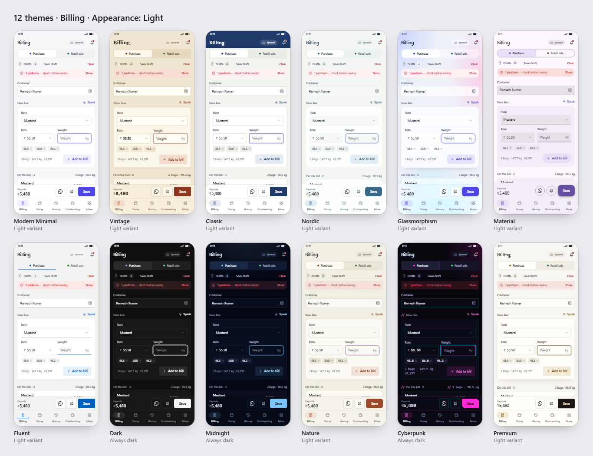
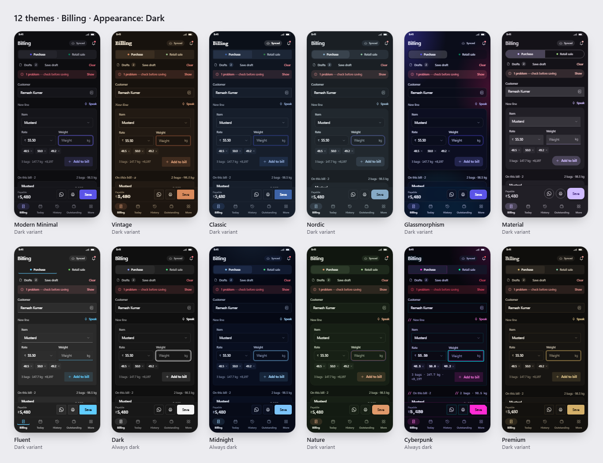

### 4.1 Two independent axes
- **Appearance:** Light / Dark / System (System follows the phone or OS live through `matchMedia('(prefers-color-scheme: dark)')`).
- **Visual theme:** one of 12 (more can be added).

The resolved state is three attributes on `<html>`:

| Attribute | Values | Set by |
|---|---|---|
| `data-theme` | `modern` (default), `vintage`, `classic`, `nordic`, `glass`, `material`, `fluent`, `dark`, `midnight`, `nature`, `cyberpunk`, `premium` | Boot snippet, then ThemeManager |
| `data-appearance` | `light` / `dark` / `system` (the user's choice, for the Settings UI) | Same |
| `data-mode` | `light` / `dark` (the **effective** mode: what CSS keys on) | Same |

`body.dark-mode` stays as an alias of `data-mode="dark"` until the old 172 `.dark-mode` selectors are converted (PR 5.11). No page code changes.

**Inherently dark themes (Dark, Midnight, Cyberpunk)** have `kind: 'dark'` in the registry and only one token set.
- Under Appearance = Light or System-light they **stay dark**. `data-mode` resolves to `dark`, so `color-scheme`, the dark bridge and the status-bar colour all agree.
- The user's Light/System choice is remembered, not applied. Switching back to a light-capable theme uses it again.
- The gallery marks these cards "Always dark". The Appearance control shows the hint "Midnight is a dark theme: Light applies to light themes."
- Rejected alternative: inventing pale "day" variants of Midnight/Cyberpunk. The neon or navy identity doesn't survive on white, and it doubles the contrast work.

### 4.2 The 12 themes: genuinely different, same usability
All keep the same layout, components, icons, mode dots, one-primary rule and figure hierarchy. They differ in palette, type roles, shape, materials and a few signature details.

| Theme | Kind | Palette (light · dark) | Type (system fonts only) | Shape and material | Signature details |
|---|---|---|---|---|---|
| **Modern Minimal** (default) | both | Graphite + indigo · graphite night | UI sans (Segoe UI Variable / Roboto) | r 8/12, hairlines, no shadows on content | "Bahi" as in §2 |
| **Vintage** | both | Parchment, sepia ink, oxblood · lamplight brown, copper | **Serif headings and hero figures**: Georgia → Iowan / Palatino → Noto Serif | r 4/6, **dashed ledger rules**, paper-edge shadow | Italic serif section titles (not in Hindi) |
| **Classic** | both | Crisp white, navy, burgundy wholesale · deep navy | Palatino titles | r 3/4, ruled table headers | **Navy masthead** app bar and sidebar |
| **Nordic** | both | Off-white, fjord blue · polar night | UI sans | r 12/18, **borderless soft panels**, more gutter and section space | Calm, low-contrast chrome (text stays AA) |
| **Glassmorphism** | both | CSS-only colour mesh (indigo, pink, sky) · deep violet mesh | UI sans | r 12/18, **translucent panels + `backdrop-filter` blur** on panels, bars and sheets | Falls back to opaque surfaces on `prefers-reduced-transparency` or the `perf-lite` class (low-end phones) |
| **Material** | both | M3 baseline tonal (seed #6750A4) · M3 dark | Roboto first, weight 500 | **Pill buttons**, **filled text fields** (bottom indicator), outlined segmented buttons, r 16 panels, tonal elevation | FAB-like Save (r 16, raised) |
| **Fluent** | both | Mica #f3f3f3, Windows accent #005fb8 · #202020 with **light accent + dark text** | Segoe UI Variable Text / Display | r 4/8, **accent underline on focused fields and selected segment**, nav pill indicator | High-contrast double focus ring |
| **Dark** | always dark | **Monochrome** charcoal, **white primary button** | UI sans, tighter display tracking | Rings instead of shadows | Colour only for modes and status |
| **Midnight** | always dark | Navy-black + faint aurora, sky-blue accent with dark text | UI sans | Ring elevation | OLED-friendly canvas |
| **Nature** | both | Oat, moss, clay · forest night | UI sans | **r 10/20 organic corners**, soft diffuse shadow | Clay primary, moss retail |
| **Cyberpunk** | always dark | Near-black **grid**, neon magenta + cyan, yellow warning | **Mono figures** (Cascadia Mono / Consolas / Roboto Mono / Droid Sans Mono) | r 2/4, **cut-corner primary**, neon hairlines, restrained glow | `// ` section-title prefix |
| **Premium** | both | Ivory, ink, gold · espresso + gold fill | **Light serif hero figures** (Iowan / Palatino, weight 400, larger) | r 6/10, soft long shadow | **Black primary with champagne text**, gold focus |

The mode accents (purchase / retail / wholesale / rentals) are re-tuned per theme but stay distinct hue families: retail is always green, so "money in" reads the same everywhere.

### 4.3 Fonts and Hindi
- **No web fonts** (CSP `font-src 'self' data:` would allow self-hosting, but the budget wouldn't: one Devanagari + Latin serif family is 150–400 KB). Every theme uses system stacks only.
- **Serif themes:** Georgia, Palatino and Iowan exist on Windows and Apple. On Android the stacks fall to `Noto Serif`.
- **Devanagari:** every stack lists `"Nirmala UI", "Noto Sans Devanagari"` **before** the generic `serif` / `monospace`. Hindi text therefore always renders in a legible Devanagari sans, even in Vintage, Classic, Premium and Cyberpunk. Only Latin text and digits take the theme face.
  - Italic is switched off for Hindi (Vintage section titles).
  - `--w-label: 400` applies in Hindi in every theme.
  - The `// ` prefix (Cyberpunk) is script-neutral.
- **Figures:** `font-variant-numeric: tabular-nums lining-nums` on all figures, so serif themes don't fall back to old-style digits in tables. Old-style numerals appear only in the Vintage hero total.

### 4.4 Pre-paint boot and the CSP hash
Today `#themeBoot` is the **inline** script at the top of `<body>` in `index.html` (not a file in `www/js/boot/`). It reads `localStorage.darkMode`, and its sha256 is pinned in the CSP (`firebase.json`) and checked by `tests/ci/security-headers.test.js` and `www/js/__tests__/theme-boot.test.js`.

**Proposal (PR 2.2):** replace it **once** with a generic, data-only snippet. Adding themes never changes it again, so the hash changes exactly once:

```js
try{var s=localStorage,d=document.documentElement,t=s.getItem('happa.theme')||'modern',a=s.getItem('happa.appearance')||(s.getItem('darkMode')==='true'?'dark':'light'),m=s.getItem('happa.themeKind')==='dark'?'dark':a==='system'?(matchMedia('(prefers-color-scheme: dark)').matches?'dark':'light'):a;d.setAttribute('data-theme',t);d.setAttribute('data-appearance',a);d.setAttribute('data-mode',m);if(m==='dark')document.body.classList.add('dark-mode');var c=s.getItem('happa.bar.'+m),e=c&&document.querySelector('meta[name="theme-color"]');if(e)e.setAttribute('content',c)}catch(x){}
```

- **No flash.** It runs before first paint. All theme token sets are in `app.css` (§4.7), so the right colours are there at the first frame. An unknown or removed theme id matches only the base `[data-theme]` block, which is Modern.
- **Legacy migration.** `darkMode=true` maps to Appearance Dark. Existing users see no change on update. ThemeManager writes the new keys and deletes `darkMode` on first save.
- The **status-bar / `theme-color`** colour for each mode is cached in `happa.bar.light|dark` by ThemeManager, so even the browser chrome is right before paint.
- **Same PR:**
  - update the hash in `firebase.json`, `docs/security.md` and both tests;
  - keep the single-inline-script guard;
  - `theme-boot.test.js` gains cases for each axis, for inherently-dark themes and for migration.
- *Rejected alternative:* move the boot code to `js/boot/theme-boot.js` and drop the hash. The CSP gets stricter, but it adds a render-blocking request before first paint on uncached starts (#209 worked to cut start time). Worth revisiting if the owner prefers a hash-free CSP.

### 4.5 Persistence: per phone, zero reads
- **Recommended: per phone.** Theme and appearance are kept in `localStorage` (`happa.theme`, `happa.appearance`, `happa.themeKind`, `happa.bar.*`), like `aadhat.lang` and `darkMode` today.
  - No Firestore reads or writes. Works offline and before sign-in (the login screen is themed too).
  - Different phones can differ: the owner's desktop in Fluent, the manager's phone in Nature.
- *Option for later:* "follow the person" in `users/{uid}.prefs.theme`. That document is already read at sign-in (`savedRanges`, #140), so it costs **0 extra reads** and 1 write per change. Local stays authoritative for pre-paint, and the server value applies after sign-in (one possible repaint).

### 4.6 Runtime switching, live preview, reset
- `www/js/ui/theme.js` (ThemeManager):
  - `apply({ theme, appearance })` sets the three attributes and `body.dark-mode`, updates `<meta name="theme-color">`, stores the keys and fires `aadhat:themechange`. Charts and any canvas-drawn UI redraw from tokens; the printed receipt does not listen.
  - A `matchMedia` listener updates `data-mode` live under System.
  - **No reload, no restart.** CSS custom properties restyle everything in one frame.
- **Gallery previews are real DOM, not screenshots.** Each card holds a tiny Billing snippet wrapped in `data-theme="<id>" data-mode="<mode>"`. Because every theme block also matches nested `[data-theme]` elements and the derived tokens are recomputed on each themed element, the card renders that theme in place. No images are shipped, and a new theme gets a preview for free.
- **Preview before applying:**
  - Tapping a card applies the theme to the whole app as a *preview*: the attributes are set, nothing is stored, and a dark preview bar shows "Previewing Vintage · Cancel · Apply" (see `phone-theme-preview-vintage.png`).
  - Apply stores it. Cancel, Back or leaving Settings restores the stored theme.
  - On desktop the gallery has a side **live preview pane** (`desktop-light-theme-gallery.png`).
- **Reset to default** sets Modern Minimal and Appearance Light (or System, see the open questions).
- **Selected / previewed / always-dark** states are marked on the cards (accent ring + check, amber ring, "Always dark" badge).

| Phone gallery | Previewing Vintage | Desktop gallery |
|---|---|---|
| 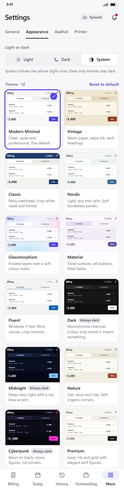 | 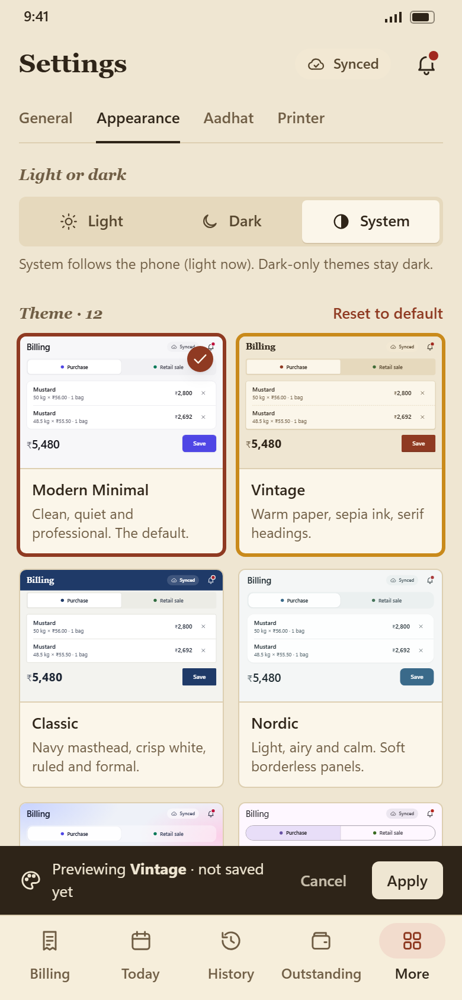 | 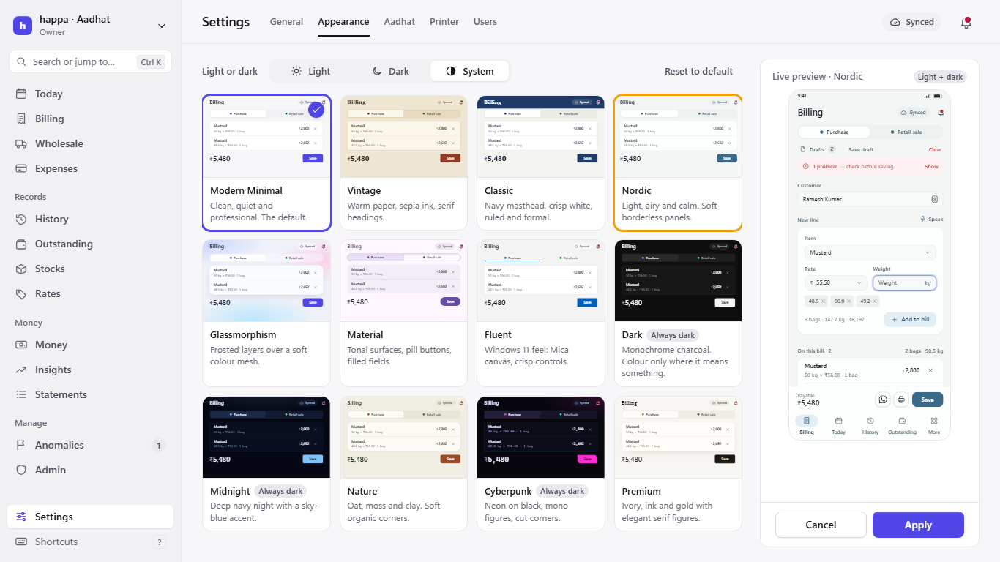 |

### 4.7 Budgets: measured
Measured with the mock files: base + Modern is 26.8 KB raw / 6.0 KB gzip, and **all 11 other themes together are 29.6 KB raw / 7.1 KB gzip**. Gzip per theme alone:

| Theme | Gzip |
|---|---|
| Dark | 0.68 KB |
| Midnight | 0.72 KB |
| Nature | 0.82 KB |
| Nordic | 0.86 KB |
| Classic | 0.96 KB |
| Glass | 1.00 KB |
| Cyberpunk | 1.04 KB |
| Fluent | 1.07 KB |
| Premium | 1.09 KB |
| Vintage | 1.10 KB |
| Material | 1.11 KB |

**Decision: bundle every theme's tokens into the one `app.css`.**
- It keeps the "1 stylesheet before login" budget and needs no precache change.
- No flash for a non-default theme, and offline works on first start.
- About +7 KB gzip, offset by the deletions in Phase 5 (the dark bridge alone is 107 selectors).
- Lazy loading (`css/themes/<id>.css` linked on demand) is rejected for now:
  - a script-inserted stylesheet is not render-blocking by default, so a non-default theme would flash Modern on every cold start;
  - it would add a precache or `LAZY_ASSETS` entry per theme.
- **Rule:** a theme may not exceed **1.5 KB gzip** or ship images or fonts. If one ever needs assets, it moves to lazy loading with a fallback to Modern while it loads. A size guard test enforces the limit.

### 4.8 What themes must not touch
- **Print and receipts.**
  - `services/printer.js` draws raster receipts on a canvas with its own fixed colours.
  - `rent-receipt.css` and `@media print` get a print reset (`[data-theme] { --bg:#fff; --ink:#000; --panel-blur:none; --font-display: var(--font-ui) … }`), so printing from any theme or mode is black on white, as today.
  - Shared bill images (WhatsApp) come from the same canvas, so they are unaffected.
  - A test prints Billing in Cyberpunk and Glass and compares with Modern.
- **JS-written inline colours** (552 writes, 482 hex). Today's bridge maps them only under `.dark-mode`. PR 2.2 makes the bridge **theme-agnostic**: `[style*="background: white"] → var(--surface)` and so on, in every theme and mode, so an unconverted screen still follows Vintage paper or Glass surfaces. Each Phase 5 PR deletes its module's inline colours and bridge entries. The bridge is gone at 5.11.
- **Layout.** Themes may not change layout or density tokens. A component override must not change box sizes (Material's filled field keeps the height; Cyberpunk's cut corner is a `clip-path` on the same box). The billing-fold E2E runs in Material and Cyberpunk too.

### 4.9 Contrast and accessibility per theme
- **Unit (fast, every PR):** `tools/theme-contrast.cjs` becomes a Jest test over `www/css/themes/*`.
  - It resolves `var()` chains and composites translucent surfaces over the canvas.
  - It checks 23 text/background pairs for each of the **21 theme × mode combinations** (ink 1–3, placeholder, accent text, button inks, status on surfaces and soft fills, toast, masthead).
  - Translucent surfaces are also tested over **every colour stop of the page mesh** (Glass, Midnight, Cyberpunk).
  - Today **all pass at ≥4.5:1** (the lowest is Material dark placeholder at 4.58). Building it caught 11 Glass failures over the mesh stops; they were fixed.
  - A new theme can't merge with a failing pair.
- **E2E (axe, real render):**
  - the existing full matrix (15 pages × en/hi × phone/desktop) stays on Modern Light;
  - a new `themes.spec` runs axe `color-contrast` on Billing, Today and Outstanding for each of the 21 combinations (en, phone): 63 page checks, about 2–3 min on one shard;
  - Hindi runs for the serif themes (Vintage, Classic, Premium) and Cyberpunk.
  - axe marks text over blurred layers "incomplete", so for Glass the E2E asserts no *violations* and the unit test above covers the mesh.
- **Reduced transparency and low-end phones:** Glass drops blur under `prefers-reduced-transparency`, or when the `perf-lite` class is set on start for devices with `navigator.deviceMemory ≤ 2` or `hardwareConcurrency ≤ 4`.
- **Focus** is visible in every theme (`--focus` per theme; Fluent and Dark use a double ring).

### 4.10 Android status bar and `theme-color`
- **Web and PWA:** the boot snippet and ThemeManager keep `<meta name="theme-color">` equal to the app bar colour for the current theme and mode (e.g. Classic navy, Vintage parchment, Midnight #050814). Chrome on Android tints the status bar and the installed PWA title bar.
- **Capacitor APK** (targetSdk 35, edge-to-edge on Android 15):
  - the WebView draws under a transparent status bar, so the app bar colour shows through;
  - the status-bar **icon** colour (light or dark) needs native code.
  - Recommended: the official `@capacitor/status-bar` plugin (small, first-party) to set `Style.Dark/Light` on `aadhat:themechange`. That is a new dependency, so it needs the owner's OK (open question).
  - Without it, keep the fixed native style and add a 1 px scrim so the icons stay readable.
- The splash screen and app icon (#109) stay theme-independent.

### 4.11 Extensibility: adding theme #13
1. Add `www/css/themes/<id>.css`: a light block (and a dark block if `kind: 'both'`), plus at most a few scoped rules. Add it to `styles.css`.
2. Add a registry entry in `www/js/ui/themes.js` (`id`, name and description `t()` keys, `kind`, bar colours) and the `en` + `hi` keys.
3. The contrast, size and E2E theme tests pick it up automatically. **No screen, component or boot change.**
---

## 5. Platform adaptation

| | Android (phone, 360–430) | Tablet / narrow web (600–1023) | Desktop / wide web (≥1024, tier ≥1440) |
|---|---|---|---|
| **Navigation** | Title app bar, 5-item bottom tab bar, More = **bottom sheet** with a grouped icon grid and the business switch. Android back closes sheets and dialogs first (`@capacitor/app` backButton) | Tab bar kept. Content column max 720, centred. Sheets become centred dialogs | Permanent sidebar (collapses to a 64 px icon rail at 1024–1279), page header, Alt+1…9, Ctrl+S/P, `/`, `?`, Esc. **Ctrl+K command palette** proposed (Phase 4, owner to confirm) |
| **Density** | 44–48 px controls, 56 px rows, 15/16 px body | Same as phone | 36 px controls, 44 px rows, 14 px body, tables instead of row lists |
| **Layouts** | One column. Billing: entry → lines → totals → payment, Save always in the action bar | One column, wider fields side by side (rate \| weight \| add) | Two columns: Billing entry + lines \| sticky 380 px summary with Save. Today metrics strip + bills table \| attention + split |
| **Materials** | Solid surfaces (no `backdrop-filter`: costly on low-end WebViews). Status-bar colour = `--bg` via `theme-color` | Same | Sidebar on `surface-2` (Mica-like tint, no blur). Menus and popovers e2 |
| **Input** | `inputmode=decimal` kept, Enter adds a weight, voice line kept, pull-to-refresh and swipe kept | Keyboard and touch | Hover states, tooltips, focus order: item → rate → weight → Add (↵) → Add to bill |
| **Breakpoints** | <600 | 600–1023 | ≥1024, ≥1440 (existing desktop.css tiers) |

---

## 6. Risks and guardrails

| Risk | Mitigation |
|---|---|
| **CSS budget** (37 KB gzip app.css; 1 stylesheet before login) | Phase 2 adds about 6 KB gzip of tokens and components, plus 7 KB gzip for the 11 extra themes but keeps one file. Each rollout PR **deletes** the page's old rules and inline styles. Target after Phase 5: app.css ≤ 170 KB raw. No new requests: the icon sprite lives in `navigation.html` (+2.5 KB gzip) |
| **CSP** | No external fonts or CDNs. Inline SVG `<use href="#…">` needs no script and no hash. `style-src 'unsafe-inline'` is untouched (and used less). Mocks are not shipped |
| **Hindi** | Labels above inputs (no wrap). `--w-label: 400`. Body 16 / line height 1.6. No uppercase or letter-spacing. Every new label is a new `t()` key in en + hi (single-language guard, "kg" rule). The axe contrast E2E runs in hi |
| **Android fonts** | Weight tokens per platform (§3.3). Check on a real phone and in the CI Linux render (different fonts from the Windows mocks) |
| **E2E selectors** | E2E uses 204 id selectors and these classes: `tab`/`.tab.active`, `bottom-nav`, `nav-menu`, `filter-purchase`, `filter-sale`, `quick-add-btn-inline`, `add-to-bill-btn`, `bill-row`, `history-item`, `bill-edits`. **Every id and these classes stay** as hooks. The new look comes from added classes. `billing-fold.spec` (Save / Print visible at 1366×768, 1280×720, 360×640 above the bottom bar) must stay green. The sticky action bar adds bottom padding to `.tab.active` so `#billDate` can scroll clear |
| **Print and receipts must not change** | `services/printer.js` (canvas raster receipts), `rent-receipt.css`, `@media print`, WhatsApp share text and images: **out of scope**. Each PR's diff is checked for these files (expected: none) |
| **JS-generated inline colours** (552 style writes, 482 hex, 107-selector dark bridge) | A small `tone` vocabulary of classes (`.t-pos/.t-neg/.t-warn/.t-muted`, `.tag.*`). Each screen PR converts its own module and removes its bridge entries. A guard test (Phase 5 end) fails on a new hex colour in `www/js` outside printer and receipts |
| **"Every displayed number needs a spec ID"** | Repeating a figure (the payable total in the action bar) reuses its spec ID. New figures (line preview, "bills not split") are only added with spec plus oracle, or dropped |
| **Functionality** | No feature removed. Drafts / Save draft / Clear become compact ghost buttons (same ids). ☰ goes away on the phone, but More opens the same menu (`#sideNav` restyled as a sheet) |
| **Performance** | No `backdrop-filter` on the phone. Transitions are transform/opacity only. Startup-perf and read-baseline E2E unchanged (no data changes) |
| **Parallel agents and cache bump** | Every `www/` PR bumps `?v=` / BUILD_ID / CACHE_NAME. Small PRs keep rebases cheap |
| **Themes: CSP hash** | The boot snippet changes once (PR 2.2) to a data-only version. Hash, docs and both tests are updated in the same PR. Adding later themes never touches it (§4.4) |
| **Themes: budget** | All 11 extra themes = 7.1 KB gzip in `app.css` (measured). Per-theme ≤1.5 KB gzip guard. No images or fonts in themes (§4.7) |
| **Themes: contrast** | Jest contrast test on all 21 theme × mode token sets (incl. mesh stops) + axe `themes.spec` on 3 key pages each (§4.9) |
| **Themes: unconverted screens** | The theme-agnostic bridge (PR 2.2) maps inline colours to tokens in every theme, so a screen not yet in Phase 5 still follows the theme's surfaces. Each Phase 5 PR is checked in 3 themes |
| **Themes: performance** | Only Glass uses `backdrop-filter`; it falls back to opaque surfaces on `perf-lite` and `prefers-reduced-transparency`. Theme switching is a single attribute change (no reload, no network) |
| **Themes: print and receipts** | Canvas receipts don't read tokens. `@media print` resets every theme to black on white. A test prints from Cyberpunk and Glass |
| **Themes: Hindi** | Every theme stack falls back to Devanagari sans before the generic serif or mono. No italics or letter-spacing in Hindi. axe in hi for the serif themes |

---

## 7. #356: merge first or supersede?

**Recommendation: supersede #356, do not merge it as the base.**
- Bahi replaces most of what #356 changed: the gradient CTA, pill and heroes, the frosted bars, the deep-navy dark theme and the global `font-weight: 500`. Merging it means shipping a look that will be reverted within days (another APK and cache churn for the shop), and the Phase 2 diff would mostly undo #356.
- The *useful* parts of #356 (44 px tap targets for `.btn` and the language switch, the Insights action-card size, the AA contrast fixes, a few template inline styles turned into classes) are carried into PR 2.1 / 2.4 on top of `main`.
- The owner decides whether to close #356 (agents don't change PR state). Until then it stays a draft for reference.

---

## 8. Phase plan (2–6), small PRs

Size: **S** < 150 changed lines, **M** 150–500, **L** 500–900 (CSS rebuild of app.css not counted).

Every PR must:
- bump the cache;
- pass CI (lint, Jest, check:sw, html-escape, E2E 3 shards incl. axe en/hi, billing-fold, read baselines);
- get an independent review;
- attach before/after screenshots (phone light/dark/hi, desktop light/dark) to the PR (as an artifact, not committed);
- keep print and receipts untouched;
- once themes exist (from PR 2.6), show the changed screens in at least Modern, one serif theme and one always-dark theme.

### Phase 2: Design system and theme engine (foundations; screens keep their layout)

| PR | Scope | Files | Screens to check | Acceptance | Size |
|---|---|---|---|---|---|
| 2.1 Tokens v2 (layered) | Layer 1 semantic and layer 2 component tokens on `:root, [data-theme]` with **Modern Minimal** values (light + `[data-mode="dark"]`). Layout tokens on `:root`. Old names aliased. Gradients → solid accent. Graphite dark. `--w-strong` / `--w-label`. Port #356's a11y fixes | `variables.css`, `app.css`, cache files | All (global recolour) | axe AA en+hi phone+desktop; no layout shift (fold spec); app.css +≤3 KB gzip | M |
| **2.2 Theme engine** | New generic `#themeBoot` (**the CSP hash changes once**). `data-theme / data-appearance / data-mode` + `body.dark-mode` alias. `ui/theme.js` ThemeManager (apply, `matchMedia` for System, `theme-color`, `aadhat:themechange`). Settings › Appearance: Light / Dark / **System** replaces the dark checkbox, with `darkMode` migration. Dark bridge made **theme-agnostic**. Print reset. Registry with Modern only. Token **contrast Jest test** (from `tools/theme-contrast.cjs`) + **size guard** (≤1.5 KB gzip per theme) | `index.html`, `firebase.json`, `docs/security.md`, `tests/ci/security-headers.test.js`, `theme-boot.test.js`, `ui/theme.js`, `ui/themes.js`, `settings.html/js`, `variables.css`, i18n | Settings; all pages in light / dark / system | csp.spec + security-headers green; no flash on reload (first-paint screenshot); System follows emulated `prefers-color-scheme`; existing `darkMode=true` users land in Dark | M |
| 2.3 Type and weight normalisation | 28 font sizes → scale tokens. 500 → tokens. Type roles (`--font-ui/-display/-num/-hero`). Platform class `platform-android` | 32 css files (mechanical), `main.js` (one line) | All | No size outside tokens (new guard `css-tokens.test.js`; baselines may only fall) | M |
| 2.4 Icon sprite and navigation icons | 51-icon sprite in `navigation.html`, `.i` CSS, `ui/icons.js`. Side menu, bottom bar and bell switch from emoji to icons | `navigation.html`, `ui/icons.js`, `navigation.css`, `hamburger.css`, tests | Menu, bottom bar, desktop sidebar | Every `#i-*` used exists. html-escape clean. Precache unchanged | M |
| 2.5a Controls | Buttons (all variants, kbd), field and input adornments, select, switch, `.seg`, `.tabs`, chips, tags, badges, all through layer-2 tokens; old classes as aliases | `buttons.css`, `tabs.css`, new `forms.css` (listed in `styles.css`) | Billing, Today, Outstanding | E2E hooks intact. Focus rings visible. 44 px targets | M |
| 2.5b Surfaces and feedback | `.panel`, `.row`, `.metric`, hero, meter, notice, empty, skeleton, toast, dialog and sheet; `tone` classes | `tables.css`, `toast.css`, `overlay.css`, `loading.css`, new `surfaces.css` | Toast, dialogs | Dialog focus trap and Esc unchanged | M |
| **2.6 Theme Gallery + batch 1** | Gallery cards with live mini previews (scoped `data-theme`), app-wide preview bar (Apply / Cancel), Reset to default, "Always dark" badge. Themes: **Modern, Nordic, Nature, Dark, Midnight** (token-only, lowest risk) | `settings.html/js`, `ui/theme.js`, new `css/themes/{nordic,nature,dark,midnight}.css`, `settings.css`, i18n (names + descriptions) | Settings › Appearance (phone + desktop); Billing, Today, Outstanding in each theme × mode | New `themes.spec`: axe on 3 pages × each theme/mode; Jest contrast + size; Cancel or leaving restores; no reload | M |
| 2.7 Docs | `docs/design-system.md` (tokens, layers, how to add a theme, do/don't). AGENTS.md UI rules (tokens only, no theme-specific selectors in page CSS, icons via `icon()`) | docs only | n/a | n/a | S |

### Phase 3: Primary screen: Billing (purchase + retail sale)

| PR | Scope | Files | Screens | Acceptance | Size |
|---|---|---|---|---|---|
| 3.1 Billing form layout | Labels above inputs, ₹/kg adornments, compact draft toolbar, slim check notice, "New line" panel, weight chips, totals and payment panel. The 52 inline styles in `billing.html` removed. All ids kept. New en+hi keys for colon-less labels | `billing.html`, `billing.css`, `totals.css`, `bill-checks.css`, i18n | Billing phone light/dark/hi, both modes | bill-flow, edit-bill, billing-fold, axe en/hi green; print unchanged | M–L |
| 3.2 Action bar | Sticky action bar on the phone (payable + WhatsApp + Print + Save), summary footer on desktop, Save keeps `#saveBillBtn` / `#saveSaleBtn` | `billing.html`, `billing.css`, `desktop.css` | Billing phone and desktop | Fold spec at all 3 sizes. Ctrl+S/P. Payable reuses its spec ID | M |
| 3.3 Billing JS output | Bill rows, weights display, check banner, drafts list (sheet) and autosave banner rendered with classes and tones (no inline hex) | `modules/billing.js`, `billing-*` helpers, `variables.css` (remove bridge entries) | Billing with lines, drafts, check failures | No `style=` colour in the billing modules (guard). Dark mode and all themes work without the bridge | M |
| **3.4 Themes batch 2** (typography themes) | **Vintage, Classic, Premium**: serif display and hero roles, dashed rules, navy masthead, black/gold primary; Hindi stays in Devanagari sans | `css/themes/{vintage,classic,premium}.css`, registry, i18n | The finished Billing + Today + Outstanding in en **and hi** × light/dark | Contrast + size guards; axe en+hi; print from these themes unchanged | S–M |

### Phase 4: Platform adaptation (shell)

| PR | Scope | Files | Acceptance | Size |
|---|---|---|---|---|
| 4.1 Phone shell | App bar with page title (from `t('ui.nav.*')`), sync pill, bell. No floating ☰ on phone. Tab bar with icon pills. `#sideNav` as a bottom sheet <1024 with a grouped grid and the business switch. Back button closes it | `navigation.html`, `navigation.css`, `hamburger.css`, `ui/bottom-nav.js`, `ui/navigation.js` | tabs-smoke (all pages, roles, sizes, languages); pull-to-refresh and swipe still work | M |
| 4.2 Desktop shell | Neutral sidebar, workspace switch, grouped nav, Alt hints, page header bar with title, mode and actions; density tokens; 64 px rail at 1024–1279 | `desktop.css`, `navigation.html` | shortcuts.spec; 1280/1366/1440/1920 screenshots | M |
| 4.3 Tablet / web breakpoints | 600–1023 centred column, sheets → dialogs ≥600, max widths | `navigation.css`, `overlay.css`, `desktop.css` | 360, 390, 412, 600, 768, 1024 screenshots | S |
| 4.4 Ctrl+K command palette (if approved) | Jump to page or action. Pure resolver unit-tested. Reuses the nav list and `t()` | `utils/command-palette.js`, `ui/…`, `keyboard-shortcuts.js` | Unit tests, a11y (combobox) | M |
| 4.5 Android polish | Weight check on device, status-bar icon style per theme (`@capacitor/status-bar` if approved), edge-to-edge insets, splash colours, overscroll | `ui/theme.js`, `android/…`, `package.json` (plugin) | rc APK smoke on a phone in Modern, Midnight and Vintage | S |
| **4.6 Themes batch 3** (material themes) | **Glassmorphism, Material, Fluent, Cyberpunk**: blur materials (with `perf-lite` / reduced-transparency fallback), filled fields, pill and cut-corner buttons, Fluent focus underline, mono figures. Checked against the new shell (bars, sheets, sidebar) | `css/themes/{glass,material,fluent,cyberpunk}.css`, registry, `main.js` (perf-lite flag) | Billing, Today, Outstanding, More sheet and desktop shell in each | Contrast (incl. mesh stops) + size guards; billing-fold in Material and Cyberpunk; 4× CPU scroll check for Glass (no jank) | M |

### Phase 5: Rollout, a few screens per PR

Each PR:
- converts its templates and JS inline colours;
- drops emoji from titles;
- removes its dark-bridge selectors;
- is checked in **Modern, Vintage and Cyberpunk** × light/dark (one plain theme, one serif-paper theme, one neon-dark theme).

| PR | Screens | Main files (inline styles / hex) | Size |
|---|---|---|---|
| 5.1 | Today › Summary | `day.html` (16), `day.js` (15/13), `day.css` | M |
| 5.2 | Today › Cash | `cash-management.html` (93), `cash-management.js` (104/88) | L (may split in two) |
| 5.3 | Outstanding / Due | `due.html`, `outstanding.js` (42/10), `outstanding.css` | M |
| 5.4 | History + Expenses | `history.js` (47/44), `miscellaneous.js` (45/26), `history.css` | M–L |
| 5.5 | Wholesale | `wholesale-sales.html` (26), `wholesale-sales.js` (59/39); reuses the Billing components, violet mode | M |
| 5.6 | Rates + Stock | `items.html`, `items.js` (32/30), `stock.js` (30/18) | M |
| 5.7 | Money + Insights + Statements | Heroes → plain hero figures; "Compare & share" kept | M |
| 5.8 | Settings, Admin, Diagnostics, Health, Anomalies | `settings.html`, `admin.js` (46/18), `diagnostics.js` (49/24), `anomalies.js` | L (split admin / settings) |
| 5.9 | Rentals | `rentals.css`, `js/rentals/*` (cyan accent; receipts unchanged) | M |
| 5.10 | Login, notifications, dialogs (`modals.html` 29), download page | `auth.css`, `notifications.css`, `modals.html` | M |
| 5.11 | Cleanup | Delete the dark bridge, dead classes and duplicated selectors. Convert the remaining `.dark-mode` selectors to `[data-mode="dark"]` and drop the alias. Guard tests: no hex in `www/js` outside printer and receipts, no colour `style=` in templates, no `[data-theme=…]` selectors outside `css/themes/` | M |

### Phase 6: Polish

| PR | Scope | Size |
|---|---|---|
| 6.1 Motion | Sheet and dialog enter/exit, tab cross-fade, row-added highlight, large-title shrink on scroll; reduced-motion respected; 4× CPU check | S–M |
| 6.2 Accessibility | Roving tabindex for seg and tabs, focus traps, `aria-live` for totals and toasts, full axe (not only contrast), screen-reader labels in hi, Android font scale 130 % | M |
| 6.3 Edge cases | Long names, ₹1,24,56,789, zero / empty / offline / error states per page, landscape phone, 1920 wide | M |
| 6.4 Visual review set | Playwright screenshot matrix (phone/desktop × light/dark × en/hi, plus the 12 themes on Billing) as a CI artifact for each UI PR | S |
| 6.6 Theme polish | 150 ms cross-fade on theme switch (off for reduced motion), gallery keyboard navigation (grid roving focus), optional "follow the person" sync if the owner wants it | S |
| 6.5 Brand | App icon and splash (#109 "Indigo Wheat" fits Bahi), manifest screenshots retaken (#151) | S |

---

## 9. Files in this folder
- `index.html`: the current #356 screenshots side by side with the proposal, plus the theme gallery and all theme renders (open locally).
- `current/*.png`: #356 screenshots (branch `ui-sleek-screens`, commit 2ff18907).
- `mocks/*.png`: the proposal. `mocks/*.html` are self-contained (inline CSS and sprite, no script).
  - `theme-<id>-<mode>.png`: Billing in each theme.
  - `themes-overview-light|dark.png`: all 12 themes at a glance.
  - `phone-light-theme-gallery.png`, `phone-theme-preview-vintage.png`, `desktop-light-theme-gallery.png`: the Theme Gallery.
- `mocks/src/ds.css`: layered tokens and components; Modern Minimal is the base.
- `mocks/src/themes/<id>.css` (one per theme) and `mocks/src/themes/registry.cjs` (id, name, description, kind).
- `mocks/src/icons.cjs`: the icon set.
- `mocks/src/build.cjs`: `node build.cjs` rebuilds the HTML, prints the CSS sizes and renders the PNGs with playwright-core.
- `tools/analyze-css.cjs`: the metrics in §1 (`node direction/tools/analyze-css.cjs` from the repo root).
- `tools/theme-contrast.cjs`: the contrast check for every theme × mode (`node direction/tools/theme-contrast.cjs --all`). It exits 1 on any pair below 4.5:1.

---

## 10. Open questions for the owner
1. **Direction and #356.** Do you approve "Bahi" (neutral, hairline, no gradients) as the base and Modern Minimal as the default theme? If so, should #356 be closed rather than merged (§7)?
2. **Where the theme choice lives.** Per phone (recommended: localStorage, zero reads, works before sign-in) or follow the person across devices (`users/{uid}`, 0 extra reads, 1 write per change)?
3. **Default appearance.** For new phones and "Reset", should Appearance be **System** (follow the phone's dark mode) or **Light** (today's behaviour)?
4. **Android status bar.** May we add the official `@capacitor/status-bar` plugin (a small first-party dependency) so the status-bar icons match dark and light themes in the APK?
5. **Extras.** Should we include a Ctrl+K command palette on desktop and the new figures shown in the mocks ("2 bills not split" on Today, the line preview "3 bags · 147.7 kg · ₹8,197")? Each new figure needs a spec ID and an oracle test.
