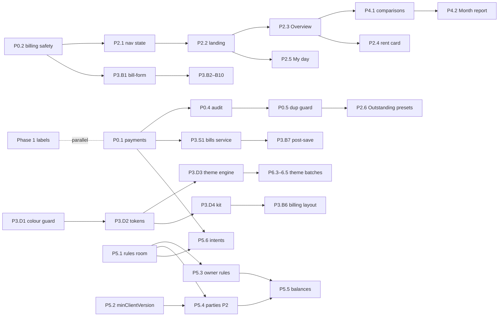

# happa V2: Implementation plan

_Product Lead, Round 3, 8 Nov 2026. Small PRs, each with acceptance criteria, the owner-approval flag, the reads impact and the rules impact. Decisions are in `PRODUCT_DECISIONS.md` (PD-xx, OD-xx); screens in `UX_REDESIGN.md`; tests in `TEST_SCENARIOS.md` (T-x)._

**Order of value (mission Round 4):** 1) core billing and daily counter work, 2) transactions and expenses, 3) owner dashboard, 4) reports and analysis, 5) rentals and platform, 6) settings, visuals and polish. Safety and truth-in-labels come before all of it.

---

## 0. Rules for every PR

1. **One concern, small diff** (S < 150 changed lines, M 150–500, L > 500 only when split is impossible). Characterise before refactoring.
2. **Cache bump** on any `www/` change (`?v=` in `index.html`, `BUILD_ID` in `main.js`, `CACHE_NAME` in `service-worker.js`); new files added to `STATIC_ASSETS` or `LAZY_ASSETS`.
3. **Numbers**: any new or changed figure gets a spec ID in `docs/calculations.md`, an oracle test and one home (`metric-registry`); label-only changes still update `calculations.md` and `docs/pages/<page>.md` + `.hi.md`.
4. **Text**: `t()` keys in `en.js` and `hi.js`, one language per screen, "kg" always, never "staff" in the UI.
5. **Styling**: tokens and kit classes only; no new hex colour or colour `style="` (guard from P3.D1).
6. **Tests**: Jest (unit/oracle), rules tests when rules change, E2E 3 shards (smoke, axe en/hi, read baselines +25 % cap 300, billing-fold).
7. **Review**: an independent code-review agent; no merge with a High/Medium finding. **MONEY** and **RULES** PRs are merged by the orchestrator after ≥ 2 review rounds. Rentals changes are real-money changes.
8. **Owner flag**: a PR marked **OWNER** does not merge before the owner's answer (OD-xx). Decided defaults are applied only after the owner replies "go" (or answers).
9. Never: comment on issues/PRs unless asked, touch production data, run destructive migrations, wipe rentals.

Legend for the tables: **Reads** = extra billed reads per app open unless stated; **Rules** = bytes added to `firestore.rules` (118,594 / 126,000 today; ~7.4 KB free); **Owner** = — / OWNER (OD-xx).

---

## Phase 0: Safety (money must never be silently wrong)

| PR | Scope | Main files | Acceptance criteria | Owner | Reads | Rules | Status |
|---|---|---|---|---|---|---|---|
| **P0.1** Payment idempotency + friendly concurrent message (D-1, D-2) | Intent id owned by a payments service (not the DOM); after a lost reply, read the bill from the server and look for the id; on a concurrent-change refusal re-read once and re-run or say "Someone just recorded ₹x; due now ₹y"; error codes mapped to `t()` keys | `services/payments.js` (new), `modules/outstanding.js`, `repos/bill-payments.js`, i18n | Dev scenario S4 (commit reply dropped, then retry) leaves **one** entry and shows "Already recorded"; S3a/S3b show translated messages with amounts, never rules text; existing payment tests green; E2E regression from `scenario.spec.js` S3/S4 added | — | 0 (+1 read only after a lost reply) | 0 | **In progress** (agent fix-double-pay) |
| **P0.2** Billing safety (S-1, D-5, S-10/S-12 messages) | Ask before saving with a filled entry row ("Add Rice 4 kg × ₹36 = ₹144?"); Billing mode no longer overridden by the timer; honest WhatsApp/print toasts | `modules/billing.js`, `purchase.js`, `retail-sale.js`, `ui/navigation.js:223`, `calc/billing`, i18n | Staff probe `03-validate.js` d) now prompts; Print/WhatsApp also prompt; `race-billing-mode.spec.js` keeps Retail; toast says "Printer not connected — receipt shown" when no printer; WhatsApp does not report a save that didn't happen | — | 0 | 0 | **In progress** (agent fix-billing-safety) |
| **P0.3** Go-live wipe keeps rentals | The wipe's keep-list covers `rent_*`, tenant links, rentals settings and `rentRole` on users | `tools/migrate/*`, tests | Unit test over the keep-list; emulator rehearsal: rentals docs and `rentRole` unchanged after wipe | — | 0 | 0 | **In progress** (PR #370, agent wipe-keep-rentals) |
| **P0.4** Audit inside the money transaction; owner edits always recorded (D-3, PD-13) | Payment, write-off and void write their audit entry in the same transaction; the owner's edit path always writes `edits/{n}` with a reason (no silent zeroing) | `services/payments.js`, `repos/bill-edit.js`, `repos/bill-payments.js`, `services/audit.js` | S4' re-run: payments on the bill == `UPDATE_PAYMENT` audit entries; owner edit in the UI creates an edit record; rules tests unchanged | — (rules enforcement is P5.3, OWNER) | 0 | 0–200 B (only if the audit create rule needs `getAfter`; verify) | After P0.1 (same files) |
| **P0.5** Duplicate-payment guard and detector (PD-22) | Warn-only at entry: "₹100 recorded on this bill 40 s ago by X — record another?"; a pure detector "same amount on one bill/charge within 10 min" over loaded data → Anomalies item, Overview attention, `npm run audit:numbers` | `services/payments.js`, `utils/detect/duplicate-payments.js` (new), `anomalies` wiring, `tools/audit` | Unit tests (same id = not a duplicate; same amount 9 min apart = flagged; 11 min = not); rentals charges covered; E2E: second identical payment shows the warning | — | 0 | 0 | After P0.1 |

**Phase 0 exit**: T3 (developer concurrency) passes in CI; no known path stores a payment twice or a bill with a dropped line.

---

## Phase 1: Correctness quick wins ("truth in labels"; parallel track, no number changes)

Runs **in parallel** with Phase 0 and Phase 2: it touches i18n, takeaways, Insights/Today/Cash labels and History, not the payment or billing files. Each PR updates `calculations.md` and page docs (en + hi).

| PR | Scope | Main files | Acceptance criteria | Owner | Reads | Rules |
|---|---|---|---|---|---|---|
| **P1.1** Remove the false takeaway (O-3) | Delete `gut_dues` ("Money in is below profit because …"); no replacement until a data-built bridge is specified | `utils/takeaways.js:58-62`, its test, i18n | The sentence never appears; takeaway tests updated; no other takeaway changes | — | 0 | 0 |
| **P1.2** Insights "Paid" → "Bought for" (O-4) | Rename the column; kg with thousands separators (`formatKg`) | i18n (`ui.insights.paid`), `modules/insights.js` | Rice row reads "Bought for ₹41,013"; "4,100 kg" | — | 0 | 0 |
| **P1.3** Today "Due to Receive / Pay" (O-12) | "New udhaar today" / "New dues to suppliers today" (T15/T16 unchanged) | i18n, `day.html` | Labels changed in en + hi; T15/T16 oracle unchanged | — | 0 | 0 |
| **P1.4** Cash page "Cash In" (O-11) | Show "Opening ₹x" as its own line; "Cash in" excludes it on the status card (display of C7's parts only) | `cash-management.js`, i18n | Same day: Today "Cash received" and Cash page "Cash in" agree; C7 unchanged | — | 0 | 0 |
| **P1.5** Drill-down keys and counts (O-10) | Add `ui.finance.group_{none,item,party,day}` (en + hi); "168 lines in 136 bills"; a test that resolves dynamic key families | i18n, `ui/finance-breakdown-sheet.js:225`, `i18n-catalogue` test | No raw key on any sheet (E2E text check); new test fails if a `group_*` key is missing | — | 0 | 0 |
| **P1.6** Rent "Collected this month" (O-5) | Relabel RENT-2 "This month's rent paid" (same number). If OD-07 = A: add **RENT-20 "Received this month"** (receipts dated in the month, from data Rentals already loads) with spec + oracle | i18n, `rentals.js` (via the rentals UI owner), `rent-math.js`, oracle | After ₹8,000 of arrears today: "This month's rent paid ₹0", "Received this month ₹8,000"; precache budget respected (free bytes first) | Label —; RENT-20 **OWNER (OD-07)** | 0 | 0 | 
| **P1.7** History › Sale includes wholesale (O-9 part, S-13) | Sale list = retail + wholesale (only with the `wholesale` permission), a type tag, a ₹ total of the filtered list; the whole row opens the bill | `modules/history.js`, `ui/bill-row.js:121`, i18n | Agent B's "last month" shows 136 bills and finds "Sharma"; total equals M1 for the period; member without permission sees retail only | — | 0 | 0 |
| **P1.8** Overdue labels; "No name" dues (O-13, PD-25) | Each figure says which question it answers: Today reminders "Parties with old dues ₹X · of which overdue ₹Y"; Insights "Bills overdue > 30 days"; no-name dues shown as "No name (old bills)" and not chased | i18n, `utils/reminders.js` (labels), `insights.js`, `outstanding.js` label only | Same numbers as before (characterisation); labels differ per question; a single definition only after OD-08 | Labels —; definition **OWNER (OD-08)** | 0 | 0 |
| **P1.9** Profit "(estimate)", one caveat, plain words (O-18, O-19) | "Profit (estimate)" while cost is unknown; caveat once; "vs 1–8 Oct"; plurals; true minus sign; "Cost of what was sold" | i18n, `money.js`, `takeaways.js` | Screenshots en/hi; no duplicate caveat; tests for plural keys | — | 0 | 0 |
| **P1.10** Small counter bugs (S-14, S-26, S-25) | Bill details order (party, money, items, actions; trace under "More details"); toasts cleared on page change; rent receipt "Close" vs void in ⋯ (skip if #363 already does it) | `history.js` details, `ui/toast`, rentals receipt (coordinate) | E2E: toast gone after navigation; details first screen shows items | — | 0 | 0 |

**Phase 1 exit**: Agent B's metric audit (owner.md §3) re-run shows no ❌ label rows except those waiting for OD-07/OD-08.

---

## Phase 2: Remembered state and role homes

| PR | Scope | Main files | Acceptance criteria | Owner | Reads | Rules |
|---|---|---|---|---|---|---|
| **P2.1** Navigation state (D-5 for every page) | `showTab()` returns a promise; pages get `onShow(state)`; remove the 6 `setTimeout` resets (`navigation.js:223–252`); remember Billing mode, Outstanding tab/filter, Wholesale view, Stock tab per phone | `ui/navigation.js`, page `onShow` hooks, `utils/ui-state.js` (new) | Leave Billing in Retail, visit Outstanding, come back → Retail; reload → Retail; Outstanding remembers Sales; no `setTimeout(` left in navigation; E2E smoke all pages | — | 0 | 0 |
| **P2.2** Landing by role + role-aware tab 2 | `landingFor(role)` (owner → Today/Overview; manager/member → Billing); tab 2 renders Overview or My day by role; override per role in Roles & access (`settings/app`) | `main.js:570`, `ui/navigation.js`, `ui/bottom-nav.js`, `settings` | Owner signs in → Overview; member → Billing with the form usable before any Overview code loads (startup-perf spec unchanged) | owner may override (OD-20) | 0 | 0 (existing `settings/app` fields; verify) |
| **P2.3** Overview (owner) | New lazy page rendering `moneySummary()` / `todaySummary()` for the period and the previous one; figures as `data-metric-ref` links; new spec IDs **T20** (money in with the bill today), **M12a / M12b** (money in with the bill / dues collected; sum = M12), comparison deltas if not already specified; attention list from existing detectors (high/medium); cached first paint "as of" from `localStorage` | `templates/overview.html`, `modules/overview.js`, `utils/business-metrics.js` (sub-figures), `metric-registry`, `calculations.md`, oracle | T2 owner scenario: five questions on one screen; every figure equals the independent total (seed-owner `truth.json`); T20 + T13 = T10 and M12a + M12b = M12 (oracle); registry test passes (no new homes except new IDs); first paint < 1 s from cache | — | **0** (Today/week/month/last month); FY/last year 1 per month | 0 |
| **P2.4** Rentals card on Overview (PD-06) | Card from the REM-2/REM-4 snapshot with "as of"; tap opens Rentals (lazy) | `modules/overview.js`, `utils/reminders.js` | `rentals-startup.test.js` and E2E rentals-startup still pass (no rentals import, 0 `rent_` reads at start); the card never adds rent to shop totals | — | 0 | 0 |
| **P2.5** My day (manager/member) | Drawer status with Open/Close, quick actions (Receive udhaar, Pay supplier, Expense), "My bills today" (T19 filtered by creator; new spec **T19m**), my reminders; managers also see permitted shop figures as references | `templates/myday.html` (or Today variant), `modules/myday.js`, i18n | Member sees no profit, net flow, labour or personal totals on My day; bills list opens details; T19m oracle; E2E member path | — | 0 | 0 |
| **P2.6** Outstanding presets (PD-18, S-19) | Counter preset (search, party cards, aging folded); owner preset (receivables, aging open); "Mark as cleared" into ⋯; members' party Receive through the payments service if OD-16 = A | `modules/outstanding.js`, `due.html` | Member: payment box above the fold at 360×640; owner: aging visible; party receive by a member uses P0.1's ids (E2E: interrupted party payment → one set of entries) | Member receive **OWNER (OD-16)** | 0 | 0 |

**Dependencies**: P2.1 after P0.2 (same `navigation.js` line). P2.6 after P0.1/P0.5 (same `outstanding.js`). P2.3–P2.5 are new files and can start at once.

**Phase 2 exit**: T2 (owner) answers the five month-end questions from the Overview in ≤ 3 taps each; T1 counter landing unchanged in speed.

---

## Phase 3: Faster billing + design-system foundation (two lanes in parallel)

### Lane DS: design-system foundation (CSS, boot, settings; no billing JS)

| PR | Scope | Main files | Acceptance criteria | Owner | Reads | Rules |
|---|---|---|---|---|---|---|
| **P3.D1** "No new inline colours" guard (D-12) | Ratchet test with per-file baselines: hex colours and colour `style="` in `www/js` and templates may only go down (printer and receipts exempt) | `tests/ci/inline-style-guard.test.js`, baseline JSON | Adding a hex in any module fails CI; baselines recorded (today: 306 JS colour declarations, 498 `style="` in JS, 290 in templates) | — | 0 | 0 |
| **P3.D2** Tokens v2, Modern Minimal (DIRECTION PR 2.1) | Layered semantic + component tokens, light and `[data-mode="dark"]`; old names aliased; gradients → solid accent; weight tokens; port #356's a11y fixes | `variables.css`, built `app.css` | axe AA en+hi phone+desktop; billing-fold green; app.css +≤ 3 KB gzip | — | 0 | 0 |
| **P3.D3** Theme engine + Appearance Light/Dark/System (DIRECTION PR 2.2, **without** extending the bridge) | Data-only boot snippet (**CSP hash changes once**); `data-theme/-appearance/-mode`; `ui/theme.js` ThemeManager (System via `matchMedia`, `theme-color`); `darkMode` migration; registry with Modern only; token contrast Jest test + per-theme size guard; print reset | `index.html`, `firebase.json`, `docs/security.md`, security-headers + theme-boot tests, `ui/theme.js`, `ui/themes.js`, `settings`, `variables.css` | csp.spec green; no flash on reload; System follows emulated scheme; `darkMode=true` users land in Dark; printing unchanged | Default appearance **OWNER (OD-12)** | 0 | 0 |
| **P3.D4** Component kit (scoped to Phase 2–3 screens) | `html` auto-escaping tagged template; Button, Field/MoneyInput, Chips/SegmentedControl, Sheet/ConfirmSheet, ActionBar, Notice/OutcomeBanner, ListRow/BillRow, KpiTile, RecordsSheet, Caveat, EmptyState; icon sprite subset | `ui/kit/*.js`, `forms.css`, `surfaces.css`, `navigation.html` (sprite) | Unit tests per component (escaping, aria); `check:html-escape` count does not rise; all E2E ids kept | — | 0 | 0 |

### Lane B: faster billing (billing JS and templates; one implementer)

| PR | Scope | Main files | Acceptance criteria | Owner | Reads | Rules |
|---|---|---|---|---|---|---|
| **P3.S1** Bills service + WriteOutcome (PD-17) | `services/bills.js` returns `saved / savedOnPhone / unconfirmed / refused(reason)`; "unconfirmed" auto-checks (as `lateCreateOutcome`); one OutcomeBanner | `services/bills.js`, `repos/bill-save.js`, billing modules | Dev S5a re-run: one bill, message "Saved" or "Checking… → Already saved"; no raw error text in any billing toast (grep guard) | — | 0 (+1 after a lost reply) | 0 |
| **P3.B1** One bill-form controller (D-11, S-8) | Characterise purchase/retail; extract the shared entry row, line list and payment block into one controller with a mode config | `modules/bill-form.js` (new), `purchase.js`, `retail-sale.js` | Characterisation snapshots unchanged except the agreed S-8 behaviour (both keep the item, clear rate and weight); duplicate-block count from `metrics.js` drops | — | 0 | 0 |
| **P3.B2** Name suggestions + "did you mean" (Parties P1, S-3) | Fill `#customerOptions`/`#saleCustomerOptions` from loaded bills (normalised names, last use first, "owes ₹x"); `utils/party-match.js` (normalised edit distance ≤ 2 or ≥ 4-char prefix) | `utils/party-match.js`, `modules/bill-form.js`, wholesale list reuse | Typing "Sit" lists "Sita Devi · owes ₹200"; "Seeta Devi" → "Did you mean Sita Devi?"; unit tests for the matcher incl. Hindi names; read baseline unchanged | — | **0** | 0 |
| **P3.B3** Line entry (S-5, S-9, S-24) | ↵ on an empty weight adds the line; "+ Bag"/"+ बोरी"; item chips (top 6 from `itemFrequency`) + search; no silent preselect; Alt+P/Alt+R; fix dead `addWeight(true)` (`main.js:1003`) | `bill-form.js`, `billing.html`, `keyboard-shortcuts.js` | Keyboard-only retail sale ≤ 20 keys, 0 clicks; phone retail cash bill ≤ 6 taps | — | 0 | 0 |
| **P3.B4** Rate prefill + extreme-rate guard (PD-03) | Prefill from today's Rates list; "changed from ₹26" mark and `rateEdited: true` on the line; blocking confirm with computed amount at the OD-02 threshold, "Fix rate" primary, override logged | `bill-form.js`, `utils/bill-checks.js`, i18n | 15 kg @ 260 vs 26 → sheet shows ₹3,900 vs ₹390 and focuses Fix rate; members per OD-02; `bill-checks` mutation score stays ≥ 90 % | **OWNER (OD-02)** threshold | 0 | 0 (line keys are not deny-listed; verify) |
| **P3.B5** Payment chips (PD-01, S-17, S-18) | [Cash][Online][Udhaar][Split…], nothing preselected; "Save · Cash ₹700"; Split = today's boxes with "Left to pay" and "Rest as udhaar"; one Total on retail; party-pay sheet uses the same chips | `bill-form.js`, `calc/billing.paymentSplit`, `outstanding.js` (party-pay, after P0.1/P2.6) | Save disabled until a chip; stored payment identical to today's for each chip (property test); no tick/amount drift (S-17 probe) | owner may override (OD-01) | 0 | 0 |
| **P3.B6** Billing layout on the kit + sticky action bar (DIRECTION 3.1–3.3) | Labels above inputs, adornments, sticky bar (Total · WA · Print · Save) on phone, summary footer on desktop; billing inline styles and hex removed | `billing.html`, `billing.css`, `desktop.css`, billing modules | billing-fold at 360×640, 1280×720, 1366×768; axe en/hi; inline-colour baseline for billing files → 0 | — | 0 | 0 |
| **P3.B7** Post-save sheet (S-10, S-11, S-21) | Saved sheet (WhatsApp, Print, UPI QR when `upiId` set, Edit, New bill); WhatsApp on the form = Save & WhatsApp; "(COPY)" only on reprints | `ui/kit/saved-sheet.js`, `bill-share.js`, `printer` calls | First share text has no "(COPY)"; History reprint has it; an unsaved bill is never shared (E2E); outcome variants render | — | 0 | 0 |
| **P3.B8** Undo Clear (S-7) | Clear keeps the form for 10 s with Undo; auto-save deleted only after the window | `bill-form.js` | Clear → Undo restores lines, name and payments; after 10 s auto-save is gone | — | 0 | 0 |
| **P3.B9** Safe corrections (S-15, PD-21) | Edit shows the re-settled split live (`editSplitFor`) and "give back ₹x cash"; "Edit this bill" from the post-save sheet | `bill-form.js` edit mode, `calc/billing.js:448` | B4→FIX re-run: boxes show ₹390 and "give back ₹3,510"; correction ≤ 7 taps from the sheet | Drawer leg **OWNER (OD-18)**, separate PR in Phase 4 | 0 | 0 |
| **P3.B10** Expense quick entry (S-22) | Type chips (frequent first), amount, Cash/Online chips, More fields folded; Expenses reachable from My day | `expenses.html`, `miscellaneous.js` | Labour ₹300 cash in ≤ 4 taps; no data-shape change | — | 0 | 0 |

**Dependencies**: P3.S1 after P0.1 (shared outcome model). P3.B1 after P0.2. P3.B2–B9 after P3.B1 (one controller). P3.B6 after P3.D2 + P3.D4. P3.B5's party-pay part after P2.6. Lane DS and Lane B are file-disjoint except `app.css` (built) and the cache-bump lines.

**Phase 3 exit**: T1 busy day ≤ 65 taps on the phone with zero silently wrong bills; T5 Hindi subset passes; Appearance Light/Dark/System works with no flash.

---

## Phase 4: Owner analysis

| PR | Scope | Main files | Acceptance criteria | Owner | Reads | Rules |
|---|---|---|---|---|---|---|
| **P4.1** Comparisons everywhere (O-7) | "vs previous period" on every Money ladder row; "Previous period" option for B; snapshot roll as an idle start-up task on owner/manager phones | `modules/money.js`, `utils/month-snapshots.js`, `main.js` idle hook | No "not known" when the previous month is in the window; Oct vs Sep in ≤ 2 taps; roll writes ≤ 2 docs | — | 0 in window; 1 per older month | 0 |
| **P4.2** Month report (O-8, PD-20, PD-31) | ST2 with last month's column, change, every row linking to its home/records; drawer reconciliation section; "What changed most" by ₹ change | `modules/statements.js` (or `month-report.js`), template, oracle | Agent B's October answers match `truth.json`; every row opens records; Share/Print/CSV unchanged for the owner | — | 0–1 | 0 |
| **P4.3** Collections split on Money (O-15) | Money › Cash shows M12a/M12b; added to month snapshots (`SNAPSHOT_VERSION` bump, forward-only rebuild) | `money.js`, `month-snapshots.js` | M12a + M12b = M12 for every month (oracle, property test); old snapshots rebuilt lazily | — | 0 (rebuild = existing roll) | 0 (verify `monthStats` key rules) |
| **P4.4** Unusual expense and purchase-rate checks (O-17, PD-23) | Pure detectors (proposed defaults: expense > 3× the 90-day median for its category and ≥ ₹2,000; purchase rate ≥ 1.4× the item's 30-day average) with spec IDs; To do + Overview attention; inline warn at expense entry | `utils/detect/expense-outlier.js`, `purchase-rate-outlier.js`, Insights, expenses | Planted ₹18,000 repair and ₹45/kg rice are flagged; nothing flagged on the plain seed; thresholds in settings | Thresholds: owner may override | 0 | 0 |
| **P4.5** Bill finder (O-9, PD-07) | All types, ₹ total, counter and owner presets, filters (period, party, item, paid-by, status incl. `rateEdited`), older months on demand with a count from snapshots, full bill-number lookup | `modules/history.js` → `bill-finder.js`, `ui/kit/records-sheet.js` | No "All time" option; "Load Sep · ≈ N bills" shows N before loading; read baselines unchanged for the default view | — | 0 default; on demand ≈ bills in the month; 1 per number lookup | 0 |
| **P4.6** Expense categories (OD-09, PD-24) | Owner-maintained list; display grouping case-insensitive now; additive `categoryId` via an owner-reviewed mapping tool (dry-run → review → apply; `type` kept) | `settings`, `expenses`, `business-metrics.js:455`, `tools/` | "Labor/Labour/labour" show as one row before any migration; mapping dry-run produces a review list; apply is reversible | **OWNER (OD-09)** | 0 | verify expense key list (likely 0) |
| **P4.7** Labour reconciliation, display only (OD-03 step 1) | "Labour: deducted ₹X · paid ₹Y · difference" with its own spec ID; paid = expenses in the labour category | `money.js`, `calculations.md` | Profit (M6) unchanged; new figure oracle-tested | **OWNER (OD-03)** | 0 | 0 |
| **P4.8** Write-off as an explicit action (OD-13, PD-13) | "Write off ₹X as bad debt" with reason in ⋯; writes the write-off entry + audit in one transaction; M5 shows it | `services/payments.js`, `outstanding.js` | Writing off ₹500 raises M5 by ₹500 and lowers O4 by ₹500; audit row present | **OWNER (OD-13)** | 0 | 0 |
| **P4.9** Owner-approved ₹ changes (one PR each, only if approved) | Round-off (OD-06), returns (OD-05), labour in profit (OD-03 B), drawer give-back leg (OD-18), commission (OD-04 B), Online sub-method (OD-21) | per item | Each: spec + oracle + migration note + rules budget check | **OWNER** | small | varies; most after P5.1 |

**Phase 4 exit**: T2 month-end with comparisons and drill-down passes; T7 read baselines unchanged.

---

## Phase 5: Platform, parties and rentals

| PR | Scope | Main files | Acceptance criteria | Owner | Reads | Rules |
|---|---|---|---|---|---|---|
| **P5.1** Rules room (D-16) | Separate dev Firebase project (#72) so the `dev_` twins can go; retire legacy-shape branches after the #126 backfill | `firestore.rules`, `rules-tests`, config, docs | Rules size drops by ~6–10 KB; all rules tests green; preview deploys use the dev project | **OWNER (OD-17)** | 0 | **−6 to −10 KB** |
| **P5.2** `minClientVersion` in rules (D-15, PD-10) | Rules compare `clientVersion` with `settings/app.minClientVersion`; app blocks new bills on old versions before creation; App health shows versions and pending writes; procedure in `docs/release-checklist.md` | `firestore.rules:676`, `main.js`, App health | E2E: old-version queued bill → raise → reconnect shows the update banner and no silent loss (procedure followed) | **OWNER** raises the value | 0 | ~100 B |
| **P5.3** Owner edits and deletes recorded by rules; due needs a name (D-3, PD-25) | Owner edits need an edit record; owner deletes only voided bills; `payment.due > 0` ⇒ non-empty party name | `firestore.rules`, rules tests | Dev S7 re-run: all three owner forgeries refused; legit owner flows pass | **OWNER (OD-14)** | 0 | ~300–600 B |
| **P5.4** Parties P2 (PD-08, OD-15) | `parties/{id}` + one `partyIndex` doc; `partyId` on new bills, created implicitly on first save with a client id (batched with the bill, offline-safe); owner set-up and merge review; migration dry-run (`docs/parties-design.md` §12 PRs 1–4, 8) | `utils/parties.js`, `repos/parties.js`, `firestore.rules`, billing, `tools/migrate` | Offline bill with a new party syncs with both docs; Outstanding totals identical before/after (property test); merge/unmerge audited | **OWNER (OD-15)** | **+1 per open** | ~1.5–2.5 KB (after P5.1) |
| **P5.5** Parties P3 balances (PD-08) | `FieldValue.increment` balances in the same batch as bills/payments; daily reconciliation "balance = Σ open dues" as an anomaly; screens switch to balances only after a clean record | repos, detector, Outstanding | Reconciliation clean on fixtures and on 30 days of shadow running; reads per open drop toward O(parties) (D-7) | **OWNER** | reduces old-bill reads | ~3–5 KB |
| **P5.6** Offline payment intents (PD-04) | Create-only `dueIntents/{intentId}` offline; applied online in the payment transaction with the intent id; "waiting to sync" | services, rules | No double application in any replay order; refused intents surface to the owner | **OWNER (OD-19)** | pending intents only | ~2 KB |
| **P5.7** Start-up weight (D-13, PD-12) | Load only the active language catalogue; lazy admin/diagnostics/anomalies; precache byte budget in `check:sw`; `printer.js` lazy with an idle preload after login (else on Billing open) | `i18n/index.js`, `main.js:21`, `service-worker.js` | Start-up requests and bytes drop; "first Print after login" E2E budget met offline and online | — | 0 | 0 |
| **P5.8** Bill number inside the create transaction (D-4) | Only if OD-10 = B | `repos/bill-save.js`, counters | No gaps under S5a; offline unchanged | **OWNER (OD-10)** | 0 | small |

**Rentals improvements** (from `rentals-agent-context.md` §6.1; after the open rentals redesign PRs #363, #364, #367, #368 merge; one agent per rentals area; precache headroom is 285 bytes, so each PR frees bytes first):

| PR and scope | Owner | Reads | Rules |
|---|---|---|---|---|
| **P5.R1** `rent_summary/current` written by the Rentals page after each receipt; Overview card reads it (1 read) | — | +1 on Overview open | ~300 B ×2 (prod + `dev_` until P5.1) |
| **P5.R2** Occupancy % and vacancy (vacant since, lost rent) — RENT-21+ with oracle (`vacantSince` on units) | owner informed (new figures) | 0 (Rentals loaded) | small (unit field) |
| **P5.R3** Outstanding per tenant with aging buckets (adapter over `utils/aging.js`) | — | 0 | 0 |
| **P5.R4** Deposits held and occupancy in the yearly report and CSV | — | 0 | 0 |
| **P5.R5** `roleAccess.rent.*` switches (e.g. members don't see totals) | **OWNER** (which switches) | 0 | 0 (UI) |
| **P5.R6** Rentals reminders in the notification bell | — | 0 | 0 |
| **P5.R7** Rentals-only user start-up path (skip Aadhat listeners) | — | reduces reads for rentals-only users | 0 |
| Not now (owner decision first): late fee, paying ahead, utilities pricing, agreement photo (needs Blaze) | **OWNER** | | |

**Phase 5 exit**: rules ≤ 120 KB after P5.1–P5.4; T4 rentals scenario passes; reads per open on the bench not above today's.

---

## Phase 6: Visual rollout, theme batches and polish (DIRECTION Phases 4–6)

| PR and scope | Acceptance criteria | Owner |
|---|---|---|---|
| **P6.1** Phone shell, desktop shell, breakpoints (DIRECTION 4.1–4.3) | tabs-smoke all pages/roles/sizes/languages; shortcuts.spec; screenshots 360–1920 | — |
| **P6.2** Screen rollout, a few per PR (DIRECTION 5.1–5.10: Today/Cash, Outstanding, History/Expenses, Wholesale, Rates/Stock, Money/Insights/Statements, Settings/Admin/Diagnostics, Rentals, Login/dialogs) | Each removes its inline colours (baseline → 0 for its files) and its dark-bridge entries; checked in Modern + one serif + one always-dark theme once they exist | — |
| **P6.3** Theme Gallery + **batch 1**: Nordic, Nature, Dark, Midnight (+ Sunlight high-contrast if OD-12) | Token contrast test for every theme × mode; **axe contrast on every converted screen × theme × mode**; preview/Apply/Cancel/Reset; no reload; size ≤ 1.5 KB gzip per theme | **OWNER (OD-12)** order |
| **P6.4** **Batch 2**: Vintage, Classic, Premium (serif roles; Hindi stays Devanagari sans) | As P6.3 plus axe in hi; print unchanged from these themes | — |
| **P6.5** **Batch 3**: Glassmorphism, Material, Fluent, Cyberpunk | As P6.3 plus billing-fold in Material and Cyberpunk; Glass falls back on `perf-lite`/reduced transparency; 4× CPU scroll check | — |
| **P6.6** Cleanup (DIRECTION 5.11) | Dark bridge deleted; `.dark-mode` → `[data-mode="dark"]`; guards at zero (no hex in `www/js` outside printer/receipts, no colour `style=` in templates) | — |
| **P6.7** Polish (DIRECTION 6.1–6.6, 4.4–4.5) | Motion with reduced-motion respected; a11y pass (roving focus, `aria-live`, font scale 130 %); edge cases (long names, ₹1,24,56,789, empty/offline/error states); visual review matrix artifact; Android status-bar plugin and Ctrl+K palette only if approved | Plugin and palette: **OWNER** |

A theme batch may ship only when its contrast tests pass for each theme × mode and axe passes on all converted screens; screens not yet converted are screenshot-checked in the batch's themes (dark themes are covered by the existing dark bridge, which is never extended).

---

## Dependencies and parallel work

| Lane (one implementer each) | Owns | Phases | Safe in parallel with |
|---|---|---|---|
| A Money writes | `services/payments.js`, `outstanding.js`, `repos/bill-payments.js`, `bill-edit.js` | P0.1, P0.4, P0.5, P2.6, P4.8 | C, D, E, F |
| B Billing form | `billing.js`, `purchase.js`, `retail-sale.js`, `bill-form.js`, `billing.html`, `bill-checks.js`, `calc/billing` | P0.2, P3.S1, P3.B1–B10 | A (except P3.B5 party-pay), C, E, F |
| C Labels | `en.js`/`hi.js` (append-only), `takeaways.js`, `insights.js`, `day.html`, `cash-management.js` labels, `finance-breakdown-sheet.js`, `history.js` | Phase 1 | all (merge i18n conflicts by keeping both) |
| D Navigation and homes | `ui/navigation.js`, `bottom-nav.js`, `main.js` landing, `overview.*`, `myday.*` | P2.1–P2.5 | A, C, E |
| E Design system | `variables.css`, `css/themes/*`, `ui/theme*.js`, `ui/kit/*`, `index.html` boot, Settings › Appearance | P3.D1–D4, Phase 6 themes | A, B (until P3.B6), C, D |
| F Owner analysis | `money.js`, `month-snapshots.js`, statements/month report, `utils/detect/*`, bill finder | Phase 4 | A, B, E |
| G Rules and platform | `firestore.rules`, `rules-tests`, `repos/parties.js`, `tools/migrate` | Phase 5 | one rules PR at a time |
| H Rentals | `js/rentals/*`, `rentals.html`, `rentals.css` | P1.6, P5.R* | after the open rentals PRs; coordinate precache bytes |

Shared hotspots: the three cache-bump lines (the merge captain re-bumps on each rebase), `app.css` (rebuilt), `en.js`/`hi.js` (append-only), `main.js` (landing in D, idle tasks in F and P5.7: sequence them).

---

## Data, migrations and rules summary

| Change | Kind | When | Owner |
|---|---|---|---|
| `rateEdited` on bill lines | Additive field, no backfill | P3.B4 | — |
| T20, T19m, M12a, M12b, RENT-20/21+, detectors | New figures (spec + oracle), no stored data except snapshot fields | P2–P5 | RENT-20 OD-07 |
| Snapshot `SNAPSHOT_VERSION` bump (M12a/M12b) | Forward-only rebuild | P4.3 | — |
| Expense `categoryId` | Additive; owner-reviewed mapping; `type` kept | P4.6 | OD-09 |
| `parties`, `partyIndex`, `partyId` | New collections + additive field; dry-run → review → apply; old bills stay name-only | P5.4 | OD-15 |
| Party balances | Derived, reconciled daily before use | P5.5 | OD-15 |
| `dueIntents` | New collection | P5.6 | OD-19 |
| `rent_summary/current` | New derived doc | P5.R1 | — |
| Rules budget | +~0.4 KB (P5.2/P5.3) +~2 KB (P5.4) +~4 KB (P5.5) +~2 KB (P5.6) against −6–10 KB (P5.1) | Phase 5 | OD-17 |

Nothing in this plan deletes or overwrites business data. Rentals data is never wiped (P0.3).
